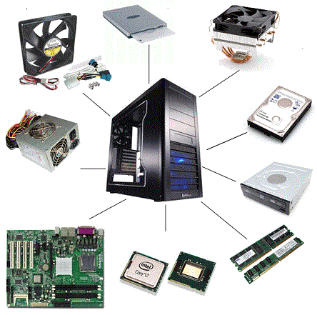
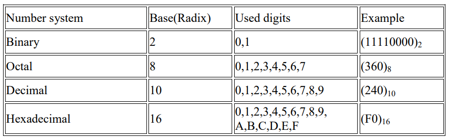
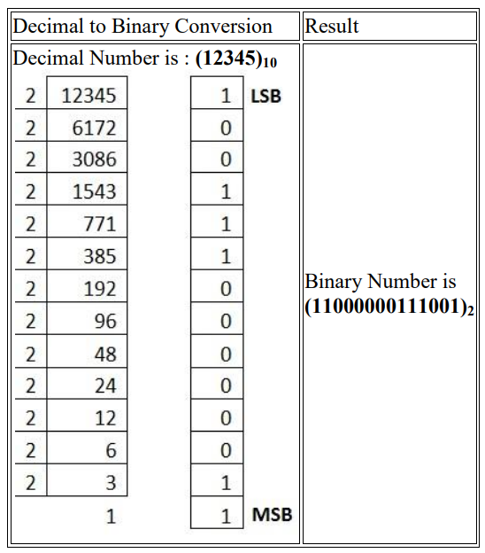
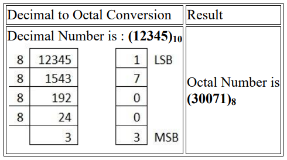
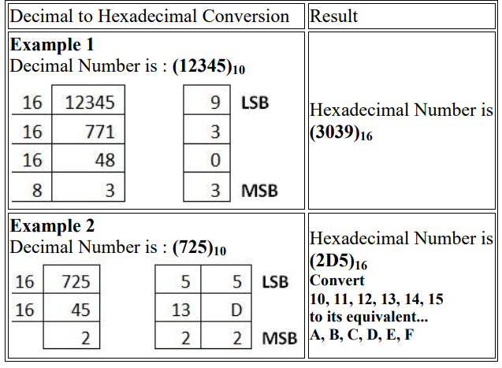
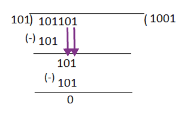

<!-- page: 1 -->
# CST1500 – Laboratory Worksheet - Week 1

These weekly laboratory worksheets provide information and exercises to complete
during class or at your own leisure. The practical exercises will assist you with your
coursework as well as provide you with valuable knowledge and skills. Please do your
best to keep up with the weekly laboratory worksheets in order to maximise your
potential for good marks and satisfactory progress in the module.
Exercises are denoted in red writing. For example:
### EX 1: Identification of PC parts (identify as many as you can).

## Contents

Lecture videos to watch this week .........................................................................................................1
Under the Lid of a Personal Computer...................................................................................................1
Number Systems.....................................................................................................................................4
Introduction to C Programming: Data Representation...........................................................................9
## Lecture videos to watch this week

Lecture 01 Data Representation 1
Lecture 02 Data Representation 2
## Under the Lid of a Personal Computer

1. Removal of cover. This varies enormously from machine to machine but generally
at least one side of the metal box of a PC can be removed for access to the
motherboard. Screws will need removing for this – take care not to remove those that
are holding something in place on the inside, e.g. the power source unit (PSU). Avoid
dropping or slamming the PC down since parts can be fragile (hard disks, a form of
secondary storage, are especially prone to such damage). The motherboard will be
exposed but remain held in place to the metal “chassis” (as in a car chassis) inside the
outer metal box. Some motherboards come in more than one piece.
2. Wires. Note that although components mounted on the motherboard can be
connected via tracks, other components require wires. For example, the hard disk (a
form of secondary storage) is connected via a “ribbon cable” (parallel wires arranged
in a flat ribbon) for data and control but also by separate wires for power. The
connectors, at the ends (or even halfway along), wires come in a variety of styles too
– ensure that you do not accidentally loosen any.
3. Static. Microelectronics inside the various components are often very sensitive to
static electricity, particularly primary memory (RAM). This is what causes tiny sparks
when taking a jumper off. Very large voltages can be generated by rubbing certain

<!-- page: 2 -->
materials together, or even just by walking on carpet. These voltages do not harm
people because only small electrical currents flow from them but they can destroy
microelectronic devices. When handling static-sensitive equipment, one should use a
special wrist strap to connect one’s body to earth (to “drain away” any static before
coming into contact with the equipment). One should at least touch the metal chassis.
Static-sensitive components are wrapped in special anti-static plastic bags. The most
obvious variety is shiny since it has a thin metallic coating on the inside surface.
4. Safety. The power source unit (PSU) takes in mains voltage electricity and gives
out lower voltages to the parts of the computer. Do not attempt to dismantle it (it is in
a metal box with slots for cooling) or push any object into it since there is a danger of
electrocution. Disconnect the whole PC from the mains to ensure that it is safe. It is
also possible to cut yourself on the many sharp edges and undersides of circuit boards.
Be especially careful when pulling a stiff connector or expansion card since your hand
can suddenly hit nearby parts.
If you could not attend the lab session, please use the following figure to answer the
questions:
### EX 1: Identification of PC parts - identify as many as you can

5. Try to sketch or photograph the locations of the following parts of the PC (remember
for each part to identify whether it is a processor, memory (primary or secondary),
input/output or support element):
a. Motherboard (also known as a system board).
b. Power source unit (PSU) – supplies power to parts (including motherboard) at
different electrical voltages.


*Figure 1 (Page 2)*


<!-- page: 3 -->
c. Fan. This makes sure that enough cooling air from outside the case is forced over
the motherboard and other components, to prevent them from overheating.
### EX 2: Identification of processor details

d. Processor/microprocessor/central processing unit (CPU) – varies enormously in
appearance. What type of processor is this and who manufactured it? Does the
processor require any additional means of cooling?
### EX 3: Identification of Memory details

e. Main memory (RAM) – usually added in small cards known as “SIMMs” or “DIMMs”
to special slots. How many slots are there for memory?
f. Secondary storage (hard disk and floppy disk, one fixed the other removable –
possibly removable “CD-ROM” too).
g. Expansion slots and expansion cards. Slots connect to expansion bus (most
commonly ISA or PCI standards) and cards can be inserted into those slots. Most
common cards: network interface card (NIC) for connecting a PC to a network; modem
for networking through a telephone line; graphics card for sending graphics information
to a monitor and sound card for sending sound signals to speakers or receiving sound
information from a microphone. Sometimes these features are built into the
motherboard itself.
One end of the card shows at the back of the PC, which is useful if something has to
be plugged into it externally. Unused slots have blank pieces of metal covering those
gaps in the case. Both cards and blanks are held in place by means of a screw.
When pulling out or pushing in cards, care must be taken not to damage them since
the slots can be quite stiff. Try not to flex the cards – push down on the edge. To pull
one out, try to ease it out using the metal part that sticks out with the screw hole in it.
### EX 4: Identification of Network Interface Card (NIC) details

What cards are present in this PC? How many slots are in use and how many are
free? Are the slots all of the same type? Would it be possible to accidentally put a card
in the wrong type of slot?
h. Ports. Most commonly USB, serial, and parallel. Also, special ports for the keyboard
and the Mouse (a pointing device) - sometimes it has its own port, otherwise it may
connect to the serial port.

<!-- page: 4 -->
## Number Systems

Number systems are the technique used to represent numbers in the computer system
architecture, every value that you are saving or getting into/from computer memory
has a defined number system. Computer architecture supports the following number
systems:
• Binary number system
• Octal number system
• Decimal number system
• Hexadecimal (hex) number system
Binary Number System
The binary number system has only two (2) digits: 0 and 1. Every number (value) is
represented with a 0 or a 1 in this number system. The base of the binary number
system is 2, because it has only two digits.
Octal Number System
The octal number system has only eight (8) digits from 0 to 7. Every number (value)
is represented with a 0, 1, 2, 3, 4, 5, 6 or 7 in this number system. The base of the
octal number system is 8, because it has only 8 digits.
Decimal Number System
The decimal number system has only ten (10) digits from 0 to 9. Every number (value)
is represented with 0, 1, 2, 3, 4, 5, 6, 7, 8 or 9 in this number system. The base of the
decimal number system is 10, because it has only 10 digits.
Hexadecimal Number System
The Hexadecimal number system has sixteen (16) alphanumeric values from 0 to 9
and A to F. Every number (value) is represented with 0, 1, 2, 3, 4, 5, 6, 7, 8, 9, A, B,
C, D, E or F in this number system. The base of the hexadecimal number system is
16, because it has 16 alphanumeric values. Here A is 10, B is 11, C is 12, D is 13, E
is 14 and F is 15.


*Figure 2 (Page 4)*


<!-- page: 5 -->
## Conversions

1. Decimal to Binary
To convert the Number system from the Decimal Number System to Any Other Base
is quite easy; you have to follow just two steps:
Step 1 - Divide the Number (Decimal Number) by the base of the target base system
of which you want to convert the number: Binary (2), Octal (8) and Hexadecimal (16).
Step 2 − Get the remainder from Step 1 as the rightmost digit (least significant digit)
of the new base number.
Step 3 − Divide the quotient of the previous divide by the new base.
Step 4 − Record the remainder from Step 3 as the next digit (to the left) of the new
base number.
Repeat Steps 3 and 4, getting remainders from right to left, until the quotient becomes
zero in Step 3.
The last remainder thus obtained will be the Most Significant Digit (MSD) of the new
base number.
Example 1 – Decimal number 12345


*Figure 3 (Page 5)*


<!-- page: 6 -->
Example 2 – Decimal number 29
| Step | Operation | Result | Remainder |
| :--- | :--- | :--- | :--- |
| Step 1 | 29 / 2 | 14 | 1 |
| Step 2 | 14 / 2 | 7 | 0 |
| Step 3 | 7 / 2 | 3 | 1 |
| Step 4 | 3 / 2 | 1 | 1 |
| Step 5 | 1 / 2 | 0 | 1 |

2. Decimal to Octal
3. Decimal to Hexadecimal


*Figure 4 (Page 6)*



*Figure 5 (Page 6)*


<!-- page: 7 -->
You are welcome to investigate further into conversions between these number
systems. See Number System Conversion (tutorialspoint.com) as a starting point.
### EX 5: Understanding of different numbering notations

Convert the decimal number 42 into binary, octal, and hexadecimal.
Show your steps.
### EX 6: Perform basic arithmetical operations on binary numbers

Explain how you solve the following addition problem in binary notation:
Show your steps.
159 + 147 =
For your answer, please mind the following rules:
• 0 + 0 = 0
• 0 + 1 = 1
• 1 + 0 = 1
• 1 + 1 = 0, and carry 1
Explain how you solve the following subtraction problem in binary notation:
Show your steps.
138 – 75 =
### EX 7: Perform complex arithmetical operations on binary numbers

Convert 18 × 24 to binary form and then perform binary multiplication.
Show your steps.
For your answer, please mind the following rules:
• 0 x 0 = 0
• 0 x 1 = 0
• 1 x 0 = 0
• 1 x 1 = 1, and no carry or borrow bits

<!-- page: 8 -->
## Binary Division:

Example: Solve using the long division method: 101101 ÷ 101
Solution:
Now convert 25 ÷ 13 to a binary form and then perform binary division.
Show your steps.
For your answer, please mind the following rules:
• 1÷1 = 1
• 1÷0 = Meaningless
• 0÷1 = 0
• 0÷0 = Meaningless


*Figure 6 (Page 8)*


<!-- page: 9 -->
## Introduction to C Programming: Data Representation

1. Introduction
In this series of lab sessions, you will learn to write your first programs in the C
programming language. You will learn how to represent and manipulate various types
of data in C and implement basic Boolean functions (i.e., digital gates).
C is a high-level and general-purpose programming language that is ideal for
developing firmware or portable applications. Originally intended for writing system
software, C was developed at Bell Labs by Dennis Ritchie for the Unix Operating
System in the early 1970s. Ranked among the most widely used languages, C has a
compiler for most computer systems and has influenced many popular languages –
notably C++.
### EX 8: Beginning with C programming I

Finding a Compiler: Before we start C programming, we need to have a compiler to
compile and run our programs. In this module, we will use the online gdb compiler
(https://www.onlinegdb.com/) that can be used to start C without installing a compiler.
What is onlinegdb.com?
• onlinegdb.com is online compiler and debugger for running and debugging C/C++
programs online itself.
• It has simple and easy to use UI interface to start with.
How to use onlinegdb.com?
• Just visit the website onlinegdb.com
• Its homepage has the editor window to write code, and in the top bar it has the
run/debug toolbar.
• If you want to run a program, just click on the "Run" button after you finish writing
your code. It will execute the program and will display the results (stdout and stderr).
• In case your code has compiler errors, it will display compiler errors.
• You can save your code online or download it onto your hard disk.
Please note: there are many other C compilers available online for free e.g.
https://www.programiz.com/c-programming/online-compiler/,
https://onecompiler.com/c, https://www.online-cpp.com/online_c_compiler,
https://www.scaler.com/topics/c/online-c-compiler/.

<!-- page: 10 -->
The following is a first program in C:
```c
#include <stdio.h>
/* It all begins here */
int main(void)
{
printf(“Hello world!”);
return 0;
}
```

To run the program, choose the C language from the drop-down menu in the upper
right and then press Run. The output will be: Hello World
Let us analyse the program line by line.
Line 1: [ #include <stdio.h> ] In a C program, all lines that start with # are processed
by the preprocessor which is a program invoked by the compiler. In a very basic term,
the preprocessor takes a C program and produces another C program. The produced
program has no lines starting with #, all such lines are processed by the preprocessor.
In the above example, the preprocessor copies the preprocessed code of stdio.h to
our file. The .h files are called header files in C. These header files generally contain
a declaration of functions. We need stdio.h for the function printf() which is used in the
program.
Line 2: [ /*] These are used for Comments that are like help text in your C program
and they are ignored by the compiler. They start with /* and terminate with the
characters */
Line 3: [ int main(void) ] There must be a starting point from where the execution of
the compiled C program begins. In C, the execution typically begins with the first line
of the main() method or function. The ‘void’ written in brackets indicates that the main
method/function doesn’t take any parameter/s. The ‘main()’ method/function can be
written to take parameters. The value returned by the main method/function indicates
the status of program termination.
Line 4 and 7: [ { and } ] In the C language, a pair of braces or curly brackets define a
scope and are mainly used in functions and control statements like if, else, loops. All
functions must start and end with curly brackets.
Line 5 [ printf(“Hello World!”); ] printf() is a standard library function to print something
as standard output. The semicolon at the end of printf indicates the line termination.
In C, a semicolon is always used to indicate the end of a statement.
Line 6 [ return 0; ] The return statement returns the value from the main()
method/function. The returned value may be used by the operating system to know
the termination status of your program. The value 0 typically means a successful
termination.

<!-- page: 11 -->
Resources for C developers:
C Programming : A Self-Teaching Introduction – Rajiv Chopra – online version
available in the Sheppard Library.
A quick C reference manual can be found at: https://www.gnu.org/software/gnu-c￾manual/gnu-c-manual.html.
C - Basic Syntax
You have seen the basic structure of a C program, so it will be easy to understand
other basic building blocks of the C programming language.
Tokens in C
A C program consists of various tokens. A token is either a keyword, an identifier, a
constant, a string literal, or a symbol. For example, the following C statement consists
of five tokens:
printf("Hello, World! \n");
The individual tokens are:
printf
(
"Hello, World! \n"
)
;
Semicolons
In a C program, the semicolon is a statement terminator. That is, each individual
statement must be ended with a semicolon. It indicates the end of one logical entity.
Given below are two different statements:
printf("Hello, World! \n");
return 0;
Let’s edit the Hello World source code and have it do something else. Alter the text so
that it looks like this:
```c
#include <stdio.h>
/* Program two */
int main( void )
{
int x, y;
x = 10;
y = x + 20;
printf(“The result is %d\n”,y);
}
```


<!-- page: 12 -->
Rebuild and test the resulting code. You should get a message that says “The result
is 30”. Most IDE editors have the usual functionality of cut/copy/paste along with
search and replace. Some also have automatic indenting, matching brace creation,
and other advanced features.
### EX 9: Beginning with C programming II

OK, what happens if you make an error in your code? We shall insert a few on purpose
and see what happens. Alter the program above so that it looks like this:
```c
#include <stdio.h>
/* Program three, with errors */
int main( void )
{
int x, y;
x = 10
y = x + 20;
printf(The result is %d\n”,y);
}
```

Note that we have left off the trailing semi-colon on x=10; as well as the leading quote
on the printf() function.
Rebuild the project. This time you will receive a bunch of errors and warnings. They
may differ in wording from development system to development system, but you
should see something about a missing semi-colon before the y. You’ll probably also
see an error concerning “The” being an undeclared identifier. You may see many
warnings as well.
Usually, double clicking on the error message will highlight the corresponding line in
the code. Sometimes a single omission can cause the compiler to emit dozens of error
messages. This is because the compiler sort of “loses track” of where it is and starts
flagging perfectly good code as having errors. For this reason, if you get errors (and
you will), always look at the first reported error and fix it. Do not look at the last reported
error as it may lead you on a wild goose chase.
Finally, you may wish to save your code for backup. Simply select File>>Save as and
choose an appropriate name. Again, C source files should use a “.c” extension e.g.
helloWorld.c
Note that you can create, read, or edit C source files without the IDE. All you need is
a simple text editor. You won’t be able to compile or build it, but you can at least get
some work done on an assignment without a compiler handy.
Comments
Comments are like helping text in your C program and they are ignored by the
compiler. They start with /* and terminate with the characters */ as shown below:
```c
/* my first program in C */
```


<!-- page: 13 -->
You cannot have comments within comments and they do not occur within a string or
character literals.
### Whitespace in C

A line containing only whitespace, possibly with a comment, is known as a blank line,
and a C compiler totally ignores it.
Whitespace is the term used in C to describe blanks, tabs, newline characters and
comments. Whitespace separates one part of a statement from another and enables
the compiler to identify where one element in a statement, such as int, ends and the
next element begins. Therefore, in the following statement:
int age;
there must be at least one whitespace character (usually a space) between int and
age for the compiler to be able to distinguish them. On the other hand, in the following
statement:
fruit = apples + oranges; // get the total fruit
no whitespace characters are necessary between fruit and =, or between = and
apples, although you are free to include some if you wish to increase readability.
C - Data Types
Data types in C refer to an extensive system used for declaring variables or functions
of different types. The type of a variable determines how much space it occupies in
storage and how the bit pattern stored is interpreted.
Types & Description
1 Basic Types
They are arithmetic types and are further classified into: (a) integer types and (b) floating-point types.
2 Enumerated types
They are again arithmetic types and they are used to define variables that can only assign certain discrete
integer values throughout the program.
Integer Types
The following table provides the details of standard integer types with their storage
sizes and value ranges:

<!-- page: 14 -->
| Type | Storage size | Value range |
| :--- | :--- | :--- |
| char | 1 byte | -128 to 127 or 0 to 255 |
| unsigned char | 1 byte | 0 to 255 |
| signed char | 1 byte | -128 to 127 |
| int | 2 or 4 bytes | -32,768 to 32,767 or -2,147,483,648 to 2,147,483,647 |
| unsigned int | 2 or 4 bytes | 0 to 65,535 or 0 to 4,294,967,295 |
| short | 2 bytes | -32,768 to 32,767 |
| unsigned short | 2 bytes | 0 to 65,535 |
| long | 4 bytes | -2,147,483,648 to 2,147,483,647 |
| unsigned long | 4 bytes | 0 to 4,294,967,295 |

### EX 10: Understanding the size program of a type/variable

To get the exact size of a type or a variable on a particular platform, you can use the
sizeof operator. The expressions sizeof(type) yields the storage size of the object or
type in bytes. Given below is an example to get the size of int type on any machine:
```c
#include <stdio.h>
#include <limits.h>
int main()
{
printf("Storage size for int : %d \n", sizeof(int));
return 0;
}
```

When you compile and execute the above program, it produces the following result on
Linux:
Storage size for int : 4
### Floating-Point Types

The following table provide the details of standard floating-point types with storage
sizes and value ranges and their precision:
| Type | Storage size | Value range | Precision |
| :--- | :--- | :--- | :--- |
| float | 4 byte | 1.2E-38 to 3.4E+38 | 6 decimal places |
| double | 8 byte | 2.3E-308 to 1.7E+308 | 15 decimal places |
| long double | 10 byte | 3.4E-4932 to 1.1E+4932 | 19 decimal places |


<!-- page: 15 -->
The header file float.h defines macros that allow you to use these values and other
details about the binary representation of real numbers in your programs. The
following example prints the storage space taken by a float type and its range values:
```c
#include <stdio.h>
#include <float.h>
int main()
{
printf("Storage size for float : %d \n", sizeof(float));
printf("Minimum float positive value: %E\n", FLT_MIN );
printf("Maximum float positive value: %E\n", FLT_MAX );
printf("Precision value: %d\n", FLT_DIG );
return 0;
}
```

When you compile and execute the above program, it produces the following result on
Linux:
Storage size for float : 4
Minimum float positive value: 1.175494E-38
Maximum float positive value: 3.402823E+38
Precision value: 6
### EX 11: Understanding the floating points program

1. What is the output of the following program? Discuss the answer with your lab tutor,
SLA or classmate.
```c
#include <stdio.h>
int main(void)
{
float x;
for (x = 0; x != 1.0; x += 0.1)
printf("%f\n", x);
return 0;
}
```

2. What is the output of the following program? Discuss the answer with your lab tutor,
SLA or classmate.
```c
#include <stdio.h>
int main(void)
{
float x;
x = 123456789.0;
printf("%f + 1 = %f\n", x, x + 1);
return 0;
}
```


<!-- page: 16 -->
### C – Variables

A variable is nothing but a name given to a storage area that our programs can
manipulate. Each variable in C has a specific type, which determines the size and
layout of the variable's memory; the range of values that can be stored within that
memory; and the set of operations that can be applied to the variable.
The name of a variable can be composed of letters, digits, and the underscore
character. It must begin with either a letter or an underscore. Upper and lowercase
letters are distinct because C is case-sensitive. Based on the basic types explained in
the previous chapter, there will be the following basic variable types:
Type & Description
char
Typically a single octet (one byte). This is an integer type.
int
The most natural size of integer for the machine.
float
A single-precision floating point value.
double
A double-precision floating point value.
void
Represents the absence of type.
Variable Definition in C
A variable definition tells the compiler where and how much storage to create for the
variable. A variable definition specifies a data type and contains a list of one or more
variables of that type as follows:
type variable_list;
Here, type must be a valid C data type including char, w_char, int, float, double, bool,
or any user-defined object; and variable_list may consist of one or more identifier
names separated by commas. Some valid declarations are shown here –
int i, j, k;
char c, ch;
float f, salary;
double d;
The line int i, j, k; declares and defines the variables i, j, and k; which instruct the
compiler to create variables named i, j and k of type int.

<!-- page: 17 -->
Variables can be initialized (assigned an initial value) in their declaration. The initializer
consists of an equal sign followed by a constant expression as follows:
type variable_name = value;
Some examples are:
extern int d = 3, f = 5; // declaration of d and f.
int d = 3, f = 5; // definition and initializing d and f.
byte z = 22; // definition and initializes z.
char x = 'x'; // the variable x has the value 'x'.
For definition without an initializer: variables with static storage duration are implicitly
initialized with NULL (all bytes have the value 0); the initial value of all other variables
is undefined.
Variable Declaration in C
A variable declaration provides assurance to the compiler that there exists a variable
with the given type and name so that the compiler can proceed for further compilation
without requiring the complete detail about the variable. A variable definition has its
meaning at the time of compilation only, the compiler needs actual variable definition
at the time of linking the program.
A variable declaration is useful when you are using multiple files and you define your
variable in one of the files which will be available at the time of linking of the program.
You will use the keyword extern to declare a variable at any place. Though you can
declare a variable multiple times in your C program, it can be defined only once in a
file, a function, or a block of code.
### EX 12: Understanding variable Declaration in C program

Try the following example, where variables have been declared at the top, but they
have been defined and initialized inside the main function:
```c
#include <stdio.h>
// Variable declaration:
extern int a, b;
extern int c;
extern float f;
int main () {
/* variable definition: */
int a, b;
int c;
float f;
/* actual initialization */
a = 10;
b = 20;
c = a + b;
```


<!-- page: 18 -->
printf("value of c : %d \n", c);
f = 70.0/3.0;
printf("value of f : %f \n", f);
return 0;
}
When the above code is compiled and executed, it produces the following result −
value of c : 30
value of f : 23.333334
C - Constants and Literals
Constants refer to fixed values that the program may not alter during its execution.
These fixed values are also called literals.
Constants can be of any of the basic data types like an integer constant, a floating
constant, a character constant, or a string literal. There are enumeration constants as
well.
Constants are treated just like regular variables except that their values cannot be
modified after their definition.
Integer Literals
An integer literal can be a decimal, octal, or hexadecimal constant. A prefix specifies
the base or radix: 0x or 0X for hexadecimal, 0 for octal, and nothing for decimal.
An integer literal can also have a suffix that is a combination of U and L, for unsigned
and long, respectively. The suffix can be uppercase or lowercase and can be in any
order.
Here are some examples of integer literals:
212 /* Legal */
215u /* Legal */
0xFeeL /* Legal */
078 /* Illegal: 8 is not an octal digit */
032UU /* Illegal: cannot repeat a suffix */
The following are other examples of various types of integer literals:
85 /* decimal */
0213 /* octal */
0x4b /* hexadecimal */
30 /* int */
30u /* unsigned int */
30l /* long */
30ul /* unsigned long */

<!-- page: 19 -->
### Floating-point Literals

A floating-point literal has an integer part, a decimal point, a fractional part, and an
exponent part. You can represent floating point literals either in decimal form or
exponential form.
While representing decimal form, you must include the decimal point, the exponent, or
both; and while representing exponential form, you must include the integer part, the
fractional part, or both. The signed exponent is introduced by e or E.
Here are some examples of floating-point literals:
3.14159 /* Legal */
314159E-5L /* Legal */
510E /* Illegal: incomplete exponent */
210f /* Illegal: no decimal or exponent */
.e55 /* Illegal: missing integer or fraction */
Character Constants
Character literals are enclosed in single quotes, e.g., 'x' can be stored in a simple
variable of char type.
A character literal can be a plain character (e.g., 'x'), an escape sequence (e.g., '\t'),
or a universal character (e.g., '\u02C0').
There are certain characters in C that represent special meaning when preceded by a
backslash for example, newline (\n) or tab (\t).
Here, you have a list of such escape sequence codes:
The following is the example to show a few escape sequence characters:
```c
#include <stdio.h>
int main() {
printf("Hello\tWorld\n\n");
return 0;
}
```

When the above code is compiled and executed, it produces the following result:
Hello World
C - Operators
An operator is a symbol that tells the compiler to perform specific mathematical or
logical functions. The C language is rich in built-in operators and provides the following
types of operators:

<!-- page: 20 -->
• Arithmetic Operators
• Relational Operators
• Logical Operators
• Bitwise Operators
• Assignment Operators
• Misc Operators
We will now look into the way each operator works.
### Arithmetic Operators

The following table shows all the arithmetic operators supported by the C language.
Assume variable A holds 10 and variable B holds 20 then:
| Operator | Description | Example |
| :---: | :--- | :--- |
| `+` | Adds two operands. | A + B = 30 |
| `−` | Subtracts second operand from the first. | A − B = -10 |
| `*` | Multiplies both operands. | A * B = 200 |
| `/` | Divides numerator by de-numerator. | B / A = 2 |
| `%` | Modulus Operator and remainder of after an integer division. | B % A = 0 |
| `++` | Increment operator increases the integer value by one. | A++ = 11 |
| `--` | Decrement operator decreases the integer value by one. | A-- = 9 |

Click here for: Further Examples
### EX 13: Write a simple program in C to add and subtract integers

Write a C program that adds and subtracts two integers.
### Relational Operators

The following table shows all the relational operators supported by C. Assume variable
A holds 10 and variable B holds 20 then:
| Operator | Description | Example |
| :---: | :--- | :--- |
| `==` | Checks if the values of two operands are equal or not. | If yes, then the |
| condition becomes true. | | |
| (A == B) | | |
| is not true. | | |
| `!=` | Checks if the values of two operands are equal or not. | If the values are |
| not equal, then the condition becomes true. | | |
| (A != B) is | | |
| true. | | |
| > Checks if the value of left operand is greater than the value of right | | |
| operand. If yes, then the condition becomes true. | | |
| (A > B) is | | |
| not true. | | |


<!-- page: 21 -->
< Checks if the value of left operand is less than the value of right operand.
If yes, then the condition becomes true.
(A < B) is
true.
>= Checks if the value of left operand is greater than or equal to the value
of right operand. If yes, then the condition becomes true.
(A >= B)
is not true.
<= Checks if the value of left operand is less than or equal to the value of
right operand. If yes, then the condition becomes true.
(A <= B)
is true.

