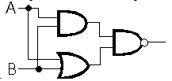
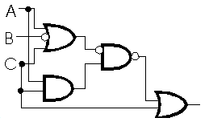
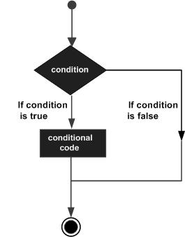
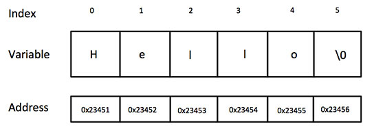

<!-- page: 1 -->
# CST1500 – Laboratory Worksheet - Week 2

These weekly laboratory worksheets provide information and exercises to complete
during class or at your own leisure. The practical exercises will assist you with your
coursework as well as provide you with valuable knowledge and skills. Please do your
best to keep up with the weekly laboratory worksheets in order to maximise your
potential for good marks and satisfactory progress in the module.
Exercises are denoted in red writing. For example:
### EX 1: Identification of PC parts (identify as many as you can).

## Contents

Lecture videos to watch this week ......................................................................................................... 1
Logical Operators using C code............................................................................................................... 1
C code Decision Making.......................................................................................................................... 5
## Lecture videos to watch this week

Lecture 03 Computer Architecture 1 and Assembly Language
Lecture 04 Introduction to Logic
Lecture 05 Sequential Logic
## Logical Operators using C code

This lab gives practical exercise on logic gates and the arithmetic operations using C
code.
Hence, the following table shows all the logical operators supported by the C
language. Assume variable A holds 1 and variable B holds 0, then
| Operator | Description | Example |
| :---: | :--- | :--- |
| `&&` | Called Logical AND operator. | If both the operands are non-zero, then the |
| condition becomes true. | | |
| (A && B) | | |
| is false. | | |
| `\|\|` | Called Logical OR Operator. | If any of the two operands is non-zero, then the |
| condition becomes true. | | |
| (A || B) is | | |
| true. | | |
| `!` | Called Logical NOT Operator. | It is used to reverse the logical state of its |
| operand. If a condition is true, then Logical NOT operator will make it false. | | |
| !(A && B) | | |
| is true. | | |


<!-- page: 2 -->
## Bitwise Operators

Bitwise operators work on bits and perform bit-by-bit operations. The truth tables for
&, |, and ^ is as follows:
| p | q | p & q | p \| q | p ^ q |
| :-: | :-: | :-: | :-: | :-: |
| 0 | 0 | 0 | 0 | 0 |
| 0 | 1 | 0 | 1 | 1 |
| 1 | 1 | 1 | 1 | 0 |
| 1 | 0 | 0 | 1 | 1 |

Assume A = 60 and B = 13 in binary format, they will be as follows −
A = 0011 1100
B = 0000 1101
-----------------
A&B = 0000 1100
A|B = 0011 1101
A^B = 0011 0001
~A = 1100 0011
The following table lists the bitwise operators supported by C. Assume variable 'A'
holds 60 and variable 'B' holds 13, then
| Operator | Description | Example |
| :---: | :--- | :--- |
| & Binary AND Operator copies a bit to the result if it exists in both | | |
| operands. | | |
| (A & B) = 12, i.e., | | |
| 0000 1100 | | |
| `\|` | Binary OR Operator copies a bit if it exists in either operand. | (A | B) = 61, |
| i.e., 0011 | | |
| 1101 | | |
| ^ Binary XOR Operator copies the bit if it is set in one operand but | | |
| not both. | | |
| (A ^ B) = 49, i.e., | | |
| 0011 0001 | | |
| ~ Binary Ones Complement Operator is unary and has the effect of | | |
| 'flipping' bits. | | |
| (~A) = -60, | | |
| i.e., 1100 | | |
| 0100 in 2's | | |
| complement form. | | |


<!-- page: 3 -->
<< Binary Left Shift Operator. The left operands value is moved left
by the number of bits specified by the right operand.
A << 2 = 240 i.e.,
1111 0000
>> Binary Right Shift Operator. The left operands value is moved right
by the number of bits specified by the right operand.
A >> 2 = 15
i.e., 0000
1111
### EX 1: Understanding digital logic (Bitwise Operators)

Let us suppose the bitwise AND operation of two integers 12 and 25.
12 = 00001100 (In Binary)
25 = 00011001 (In Binary)
Bit Operation of 12 and 25
00001100
& 00011001
________
00001000 = 8 (In decimal)
Study and understand the program below. What is the expected output?
```c
#include <stdio.h>
int main()
{
int a = 12, b = 25;
printf("Output = %d", a&b);
return 0;
}
```

Study and understand the program below. What is the expected output? Why?
```c
#include <stdio.h>
int main()
{
int a = 12, b = 25;
printf("Output = %d", a|b);
return 0;
}
```

Study and understand the program below. What is the expected output? Why?
```c
#include <stdio.h>
int main()
{
int a = 12, b = 25;
printf("Output = %d", a^b);
return 0;
}
```


<!-- page: 4 -->
### EX 2: Introduction to digital logic

Draw digital logic circuits for these Boolean expressions and replicate your circuit
using the Logic.ly simulator (https://logic.ly/demo). Use the provided inputs and
discuss your output.

ABC + ABD + BCD
(AB + CD)AD
(AC + B + CD)E
### EX 3: Understanding of sequential logic and Boolean expressions

Give the equivalent Boolean expressions for these digital logic circuits and replicate
your circuit using the Logic.ly simulator. Use the provided inputs and discuss your
output.
A.
B.
### EX 4: Understanding of digital logic in a C program

Write a C program that will read two digits from the keyboard and output different logic
gates, namely AND, OR, XOR and NOT. Test your program and see if it produces the
correct output by checking the corresponding truth tables.


*Figure 1 (Page 4)*



*Figure 2 (Page 4)*


<!-- page: 5 -->
## C code Decision Making

Decision making structures require that the programmer specifies one or more
conditions to be evaluated or tested by the program, along with a statement or
statements to be executed if the condition is determined to be true, and optionally,
other statements to be executed if the condition is determined to be false.
Show below is the general form of a typical decision-making structure found in most
of the programming languages:
The C programming language assumes any non-zero and non-null values as true,
and if it is either zero or null, then it is assumed as a false value.
C - Using Conditionals
In this exercise we will be taking a look at using conditionals. These include the if/else
construct and the switch/case construct. Conditionals are used to make a choice, that
is, to split the program flow into various paths. The if/else works best with simple
either/or choices while the switch/case is designed to deal with one (or possibly
multiple) choice(s) from a list of fixed possibilities.
The C programming language provides the following types of decision-making
statements:


*Figure 3 (Page 5)*


<!-- page: 6 -->
| Sr.No. | Statement & Description |
| :---: | :--- |
| **1** | **if statement**<br>An if statement consists of a boolean expression followed by one or more statements. |
| **2** | **if...else statement**<br>An if statement can be followed by an optional else statement, which executes when the |

Boolean expression is false.
3 nested if statements
You can use one if or else if statement inside another if or else if statement(s).
4 switch statement
A switch statement allows a variable to be tested for equality against a list of values.
5 nested switch statements
You can use one switch statement inside another switch statement(s).
The simplest conditional is the straight if(). Depending on whether or not the item(s) to
be tested evaluate to true determines if subsequent action is taken. By grouping
clauses with the logical operators || and &&, complex tests may be created. if()
statements may be nested as well as include processing for the test failure by using
the else clause. If you need to choose a single item from a list, for example when
processing a menu selection, this may be achieved through nesting in the following
fashion:
if(choice == 1)
{
/* do stuff for 1 */
}
else
{
if(choice == 2)
{
/* do stuff for 2 */
}
else
{
if(choice == 3)
{
/* do stuff for 3 */
}
/* and so on */
}
}

<!-- page: 7 -->
This arrangement is a bit cumbersome when choosing from a large list. Also, it is
difficult to deal with a plural choice (e.g., picking items 1 and 3). For these situations
the C language offers the switch/case construct. There is nothing a switch/case can
do that you can’t recreate with nested if/else’s and additional code, but the former
offers greater convenience as well as clearer and more compact code. The
switch/case is used frequently, but ultimately, the if/else is more flexible because it is
not limited to choosing from a list of numeric values. Ordinarily, numeric constants are
not used in production code, as in the example above. Instead, #define’s are used for
the constants in order to make the code more readable. A real-world switch/case
version of the previous example might look like:
#define WALK_DOG 1
#define LET_OUT_CAT 2
#define COMB_WOMBAT 3
switch( choice )
{
case WALK_DOG:
/* c’mon poochie... */
break;
case LET_OUT_CAT:
/* there’s the door... */
break;
case COMB_WOMBAT:
/* first the shampoo... */
break;
/* and so on */
}
Example 1: if statement
// Program to display a number if it is negative
```c
#include <stdio.h>
int main()
{
int number;
printf("Enter an integer: ");
scanf("%d", &number);
// true if number is less than 0
if (number < 0)
{
printf("You entered %d.\n", number);
}
printf("The if statement is easy.");
return 0;
}
```


<!-- page: 8 -->
Output 1
Enter an integer: -2
You entered -2.
The if statement is easy.
When the user enters -2, the test expression number<0 is evaluated to true. Hence,
You entered -2 is displayed on the screen.
Output 2
Enter an integer: 5
The if statement is easy.
When the user enters 5, the test expression number<0 is evaluated to false and the
statement inside the body of if(number < 0) is not executed.
if...else Statement
The if statement may have an optional else block. The syntax of the if...else statement
is:
if (test expression) {
// statements to be executed if the test expression is true
}
else {
// statements to be executed if the test expression is false
}
How does the if…else statement work?
If the test expression is evaluated to true,
• statements inside the body of if are executed.
• statements inside the body of else are skipped from execution.
If the test expression is evaluated to false,
• statements inside the body of else are executed
• statements inside the body of if are skipped from execution.
Example 2: if...else statement
// Check whether an integer is odd or even
```c
#include <stdio.h>
int main()
{
int number;
printf("Enter an integer: ");
scanf("%d", &number);
```


<!-- page: 9 -->
// True if the remainder is 0
if (number%2 == 0)
{
printf("%d is an even integer.",number);
}
else
{
printf("%d is an odd integer.",number);
}
return 0;
}
Output
Enter an integer: 7
7 is an odd integer.
When the user enters 7, the test expression number%2 == 0 is evaluated to false.
Hence, the statement inside the body of else is executed.
### EX 5: Basic exercise of if…else statement

Write a program where the user is asked to enter their age and based on the input,
the if…else statement checks whether the entered age is greater than or equal to 18.
If this condition is met, display the message “You are eligible for voting”. However, if
the condition is not met, display a different message “You are not eligible for voting”.
The output should look like the following:
Output
Enter your age:14
You are not eligible for voting
OR
Enter your age:21
You are eligible for voting
### EX 6: Basic exercise of if else statement

Write a C program to accept two integers and check whether they are equal or not.
This can be done through using the if…else statement and the program should relate
the two integers using =, > or < symbols.
The output should look like the following:

<!-- page: 10 -->
Enter two integers: 12
23
Result: 12 < 23
OR
Enter two integers: 9
9
Result: 9 = 9
And so on…
C – Strings
Strings are actually a one-dimensional array of characters terminated by a
nullcharacter '\0'. Thus, a null-terminated string contains the characters that comprise
the string followed by a null.
The following declaration and initialization create a string consisting of the word
"Hello". To hold the null character at the end of the array, the size of the character
array containing the string is one more than the number of characters in the word
"Hello."
char greeting[6] = {'H', 'e', 'l', 'l', 'o', '\0'};
If you follow the rule of array initialization then you can write the above statement as
follows:
char greeting[] = "Hello";
The following is the memory presentation of the above defined string in C:
Actually, you do not place the null character at the end of a string constant. The C
compiler automatically places the '\0' at the end of the string when it initializes the
array. Let us try to print the above-mentioned string.


*Figure 4 (Page 10)*


<!-- page: 11 -->
```c
#include <stdio.h>
int main ()
{
char greeting[6] = {'H', 'e', 'l', 'l', 'o', '\0'};
printf("Greeting message: %s\n", greeting );
return 0;
}
```

When the above code is compiled and executed, it produces the following result:
Greeting message: Hello
C supports a wide range of functions that manipulate null-terminated strings:
Sr.No. Function & Purpose
1 strcpy(s1, s2);
Copies string s2 into string s1.
2 strcat(s1, s2);
Concatenates string s2 onto the end of string s1.
3 strlen(s1);
Returns the length of string s1.
4 strcmp(s1, s2);
Returns 0 if s1 and s2 are the same; less than 0 if s1<s2; greater than 0 if s1>s2.
5 strchr(s1, ch);
Returns a pointer to the first occurrence of character ch in string s1.
6 strstr(s1, s2);
Returns a pointer to the first occurrence of string s2 in string s1.
The following example uses some of the above-mentioned functions:
```c
#include <stdio.h>
#include <string.h>
int main ()
{
char str1[12] = "Hello";
char str2[12] = "World";
char str3[12];
int len ;
/* copy str1 into str3 */
strcpy(str3, str1);
printf("strcpy(str3, str1) : %s\n", str3 );
```


<!-- page: 12 -->
/* concatenates str1 and str2 */
strcat(str1, str2);
printf("strcat(str1, str2): %s\n", str1);
/* total length of str1 after concatenation */
len = strlen(str1);
printf("strlen(str1) : %d\n", len);
return 0;
}
When the above code is compiled and executed, it produces the following result:
strcpy(str3, str1) : Hello
strcat(str1, str2): HelloWorld
strlen(str1) : 10
C- Introduction to Addresses, Pointers and Handles
All variables and functions have an address (memory location) associated with them.
This is where they "live". For multiple byte entities, this is the starting address of the
memory block the item occupies. The address of any variable (with the exception of
register class) can be found with the & operator. Depending on the operating system,
the address will generally be contained within either 2 bytes or 4 bytes in length (8
bytes for a 64 bit OS). That is, all possible addresses in the system can be so
described. If an address is placed into another variable, this other variable is said to
be a pointer (i.e., it stores the address of, or "points to", the first variable).
In order to take advantage of type checking and pointer math, pointers are declared
by the type of item they point to, even though all pointers are themselves the same
size. Thus, a pointer is properly declared as a pointer to a type char or a pointer to a
type float, for example. The * operator is used to indicate that the declaration is of a
pointer. For example:
int *pc;
declares a pointer to an int.
int c, *pc;
c = 12;
pc = &c;
This chunk of code declares an int and a pointer to an int, assigns 12 to the int (c), and
then places the address of the int (c) in the pointer (pc). The value of the item pointed
to can be retrieved through the indirection operator *. Consider the following addition
to the above:
printf("The value of c = %d, the address of c = %d\n", c, &c );
printf("The value of pc = %d, the value pc points to = %d\n", pc,
*pc );

<!-- page: 13 -->
Note that c and *pc are the same value (12). Also, note that if the value of c is changed,
*pc reflects this change. Thus, adding
c = 36;
printf("New value of c = %d, the address of c = %d\n", c, &c );
printf("The value of pc = %d, the value pc points to = %d\n", pc,
*pc );
will show 36 for *pc as well as c, and the addresses will not have changed.
### EX 7: Basic c code for pointers concept I

### Exercise One : Create a small program based on the above code and run it. What do

you notice?
What if the address of the pointer is stored in another pointer? This is called a handle.
Consider the following code fragment:
int c, *pc, **ppc;
c = 12;
pc = &c;
ppc = &pc;
printf("pc = %d, the value pc points to = %d\n", pc, *pc );
printf("ppc = %d, the value ppc points to = %d\n", ppc, *ppc );
### EX 8: Basic c code for pointers concept II

### Exercise Two: Alter your program to reflect the above. Run it and compare your

results. What do you think the value **ppc is? (Try it).
Addresses can be sent as arguments to functions. This is how a function can return
more than one value and is an important concept to remember. Consider the following:
```c
int main( void )
{
int a, b, c, *pc;
pc = &c;
assign_it(&a, &b, pc);
printf(“The values in main are: %d %d %d\n”, a, b, c);
}
void assign_it(int *x, int *y, int *z)
{
*x = 1;
*y = 20;
*z = 300;
}
```


<!-- page: 14 -->
Note that assign_it() can be called using either the address of operator (&) on an
existing variable, or by passing a pointer to a variable (as in the case of &c or pc).
Also, assign_it()’s declaration states that it is accepting pointers to int, not plain old int.
Pointers become much more important when working with arrays and more complex
C programs. Feel free to explore arrays and pointers in more detail.

