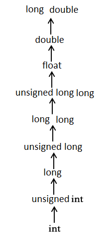

<!-- page: 1 -->
# CST1500 – Laboratory Worksheet - Week 3

These weekly laboratory worksheets provide information and exercises to complete
during class or at your own leisure. The practical exercises will assist you with your
coursework as well as provide you with valuable knowledge and skills. Please do your
best to keep up with the weekly laboratory worksheets in order to maximise your
potential for good marks and satisfactory progress in the module.
Exercises are denoted in red writing. For example:
### EX 1: Identification of PC parts (identify as many as you can).

## Contents

Lecture videos to watch this week .........................................................................................................1
Coursework One .....................................................................................................................................1
C code Using Standard I/O (Input/Output).............................................................................................1
C code Using Loops.................................................................................................................................9
## Lecture videos to watch this week

Lecture 06 Memory and Storage Systems
Lecture 07 Input Output
There will be a FORMATIVE test available next week which will cover lectures 1 - 6.
## Coursework One

Coursework One will be presented by your lab tutor and discussed in more detail.
The coursework specification can be found on the course page in the Coursework
One section. If you have any questions, please be prepared with them.
## C code Using Standard I/O (Input/Output)

In this lab session we will explore the input/output values using C code.
When we say Input, it means to feed some data into a program. An input can be given
in the form of a file or from the command line. C programming provides a set of built￾in functions to read the given input and feed it to the program as per a requirement.
When we say Output, it means to display some data on screen, printer, or in any file.

<!-- page: 2 -->
C programming provides a set of built-in functions to output the data on the computer
screen as well as to save it in text or binary files.
In this exercise we will be taking a closer look at the Standard I/O functions printf() and
scanf(). We shall also investigate the use of multiple user functions and prototypes.
Further, we shall investigate the importance of proper program specification as well as
choosing proper variable types.
When designing a program, try to keep the user interaction as simple and as clear as
possible. Also, try to structure the code to facilitate maintenance. Studies have shown
that majority of programming time spent on non-trivial applications is in the area of
maintenance (adding features, fixing bugs, etc.). Strive to make your code as clear as
glass and include appropriate comments. Do not, however, add comments to code
that even a novice would understand as that just creates clutter. Here is an example
of bad commenting:
a = b + c; /* add b to c */
This comment adds nothing to the quality of the code. Similarly, use mnemonic
variable names where possible. This helps to create self-commenting code. Here is
an example:
x = y + z * 60;
total_seconds = seconds + minutes * 60;
These two lines of code perform the same mathematical operations, but the second
line gives you a hint as to what is intended. The first line would probably need a
comment to make sense of it while the second line stands by itself.
The Standard Files
C programming treats all the devices as files. So, devices such as the display are
addressed in the same way as files. The following three files are automatically opened
when a program executes to provide access to the keyboard and screen.
Standard File File Pointer Device
Standard input stdin Keyboard
Standard output stdout Screen
Standard error stderr Your screen
The file pointers are the means to access the file for reading and writing purpose. This
section explains how to read values from the screen and how to print the result on the
screen.

<!-- page: 3 -->
### The getchar() and putchar() Functions

The int getchar(void) function reads the next available character from the screen and
returns it as an integer. This function reads only a single character at a time. You can
use this method in a loop in case you want to read more than one character from the
screen.
The int putchar(int c) function puts the passed character onto the screen and returns
the same character. This function puts only a single character at a time. You can use
this method in a loop in case you want to display more than one character on the
screen.
### EX 1: Basic Input/ output examples

Check the following example:
```c
#include <stdio.h>
int main()
{
int c;
printf("Enter a value: ");
c = getchar();
printf("\nYou entered: ");
putchar(c);
return 0;
}
```

When the above code is compiled and executed, it waits for you to input some text.
When you enter some text and press enter, the program proceeds and reads only a
single character and displays it as follows:
Enter a value: this is a test
You entered: t
### The gets() and puts() Functions

The char gets(char s) function reads a line from stdin into the buffer pointed to by s
until either a terminating newline or EOF (End of File).
The int puts(const char s) function writes the string 's' and a trailing newline to stdout.
```c
#include <stdio.h>
int main( )
{
char str[100];
printf("Enter a value: ");
gets(str);
```


<!-- page: 4 -->
printf("\nYou entered: ");
puts(str);
return 0;
}
When the above code is compiled and executed, it waits for you to input some text.
When you enter a text and press enter, then the program proceeds and reads the
complete line till end, and displays it as follows:
Enter a value: this is a test
You entered: this is a test
### The scanf() and printf() Functions

The int scanf(const char *format, ...) function reads the input from the standard input
stream stdin and scans that input according to the format provided.
The int printf(const char *format, ...) function writes the output to the standard output
stream stdout and produces the output according to the format provided.
The format can be a simple constant string, but you can specify %s, %d, %c, %f, etc.,
to print or read strings, integer, character or float respectively. There are many other
formatting options available which can be used based on requirements. Let us now
proceed with a simple example to understand the concepts better:
```c
#include <stdio.h>
int main( )
{
char str[100];
int i;
printf("Enter a value :");
scanf("%s %d", str, &i);
printf("\nYou entered: %s %d ", str, i);
return 0;
}
```

When the above code is compiled and executed, it waits for you to input some text.
When you enter some text and press enter, the program proceeds and reads the input
and displays it as follows:
Enter a value : seven 7
You entered: seven 7
Here, it should be noted that scanf() expects input in the same format as you provided
%s and %d, which means you have to provide valid inputs like "string integer". If you
provide "string string" or "integer integer", then it will be assumed as wrong input.

<!-- page: 5 -->
Secondly, while reading a string, scanf() stops reading as soon as it encounters a
space, so "this is a test" is four strings for scanf().
### C - Type Casting

Type casting is a way to convert a variable from one data type to another data type.
For example, if you want to store a 'long' value into a simple integer then you can type
cast 'long' to 'int'. You can convert the values from one type to another explicitly using
the cast operator as follows:
(type_name) expression
Consider the following example where the cast operator causes the division of one
integer variable by another to be performed as a floating-point operation:
```c
#include <stdio.h>
main()
{
int sum = 17, count = 5;
double mean;
mean = (double) sum / count;
printf("Value of mean : %f\n", mean );
}
```

When the above code is compiled and executed, it produces the following result:
Value of mean : 3.400000
It should be noted here that the cast operator has precedence over division, so the
value of sum is first converted to type double and finally it gets divided by count yielding
a double value.
Type conversions can be implicit which is performed by the compiler automatically, or
it can be specified explicitly through the use of the cast operator. It is considered good
programming practice to use the cast operator whenever type conversions are
necessary.
### Integer Promotion

Integer promotion is the process by which values of integer type "smaller" than int or
unsigned int are converted either to int or unsigned int. Consider an example of adding
a character with an integer:
```c
#include <stdio.h>
main()
{
int i = 17;
char c = 'c'; /* ascii value is 99 */
int sum;
```


<!-- page: 6 -->
sum = i + c;
printf("Value of sum : %d\n", sum );
}
When the above code is compiled and executed, it produces the following result:
Value of sum : 116
Here, the value of sum is 116 because the compiler is doing integer promotion and
converting the value of 'c' to ASCII before performing the actual addition operation.
### Usual Arithmetic Conversion

The usual arithmetic conversions are implicitly performed to cast their values to a
common type. The compiler first performs integer promotion. If the operands still have
different types, then they are converted to the type that appears highest in the following
hierarchy:
The usual arithmetic conversions are not performed for the assignment operators, nor
for the logical operators && and ||. Let us take the following example to understand
the concept:
```c
#include <stdio.h>
main()
{
int i = 17;
char c = 'c'; /* ascii value is 99 */
float sum;
sum = i + c;
printf("Value of sum: %f\n", sum);
}
```



*Figure 1 (Page 6)*


<!-- page: 7 -->
When the above code is compiled and executed, it produces the following result −
Value of sum: 116.000000
Here, it is simple to understand that first c gets converted to an integer, but as the final
value is double, usual arithmetic conversion applies and the compiler converts i and c
into 'float' and adds them yielding a 'float' result.
### EX 2: C programs to print user name and integer

1. Write a C program to print your name.
Expected output:
Name: your name
2. Write a C program to print an integer entered by the user.
Expected output:
Enter an integer: 25
You entered: 25
### EX 3: C program to add two integers

Write a C program to add two integers entered by the user.
Expected output:
Enter two integers: 12
11
12 + 11 = 23
### EX 4: C program to multiply two decimal numbers

Write a C program to multiply two decimal numbers entered by the user.
Expected output:
Enter two numbers: 2.4
1.12
Product = 2.69
### EX 5: C program to find ASCII value of a character

Write a C program to find the ASCII value of character entered by the user.
Expected output:
Enter a character: G
ASCII value of G = 71

<!-- page: 8 -->
### EX 6: C program for dividing two integers

Write a C program to compute the quotient and remainder of two integers entered by
the user.
Expected output:
Enter dividend: 25
Enter divisor: 4
Quotient = 6
Remainder = 1
### EX 7: Perform more advanced tasks in C program to find out the size of int, float,

double and char of your system
Write a C program to find the size of int, float, double and char of your system.
Expected output:
Size of int: 4 bytes
Size of float: 4 bytes
Size of double: 8 bytes
Size of char: 1 byte
### EX 8: Perform more advanced tasks in C program to swap to numbers

Write a C program to swap two numbers entered by the user.
Expected output:
Enter first number: 1.20
Enter second number: 2.45
After swapping, firstNumber = 2.45
After swapping, secondNumber = 1.20

<!-- page: 9 -->
## C code Using Loops

In this section, we will be taking a look at using loops, or iteration. We shall also
investigate a few functions in the standard library. Computers are of course ideal for
repetitive calculations such as those needed to create data tables.
If a specific number of iterations are required, usually the for() loop construct is the
best choice. For situations where the precise number of iterations is not known, or
where the termination condition can be expressed in an easier fashion, the while()
loop construct is preferred. This exercise shall focus on using the while() construct,
although it is recommended that upon completion you attempt to alter the code to
utilise the for() construct.
### EX 9: basic code for understanding the for loop in C code

Example 1: The for loop
/* Print numbers from 1 to 10 */
```c
#include <stdio.h>
int main()
{
int i;
for (i = 1; i < 11; ++i)
{
printf("%d ", i);
}
return 0;
}
```

Output
1 2 3 4 5 6 7 8 9 10
1. i is initialized to 1.
2. The test expression i < 11 is evaluated. Since 1 less than 11 is true, the body of
for loop is executed. This will print the value of i on the screen - 1.
3. The update statement ++i is executed. Now, the value of i will be 2. Again, the test
expression is evaluated to true, and the body of for loop is executed. This will print 2,
the value of I, on the screen.
4. Again, the update statement ++i is executed and the test expression i < 11 is
evaluated. This process goes on until i becomes 11.
5. When i becomes 11, i < 11 will be false, and the for loop terminates.

<!-- page: 10 -->
### EX 10: Explain the following for loop C program and what is the expected

output?
/* Program to calculate the sum of first n natural numbers
Positive integers 1,2,3...n are known as natural numbers */
```c
#include <stdio.h>
int main()
{
int num, count, sum = 0;
printf("Enter a positive integer: ");
scanf("%d", &num);
// for loop terminates when num is less than count
for(count = 1; count <= num; ++count)
{
sum += count;
}
printf("Sum = %d", sum);
return 0;
}
```

### EX 11: Basic C code to understand number conversions

Study and understand the program below. What is the expected output?
```c
#include<stdio.h>
#include<conio.h>
#include<math.h>
void dec_bin(long int num)
{
long int rem[50],i=0,length=0;
while(num>0)
{
rem[i]=num%2;
num=num/2;
i++;
length++;
}
printf("nBinary number : ");
for(i=length-1;i>=0;i--)
printf("%ld",rem[i]);
}
void main()
{
long int num;
printf("Enter the decimal number : ");
scanf("%ld",&num);
dec_bin(num); // Calling function
}
```


<!-- page: 11 -->
### EX 12: Binary to decimal numbers conversion

Now Write a C program to convert binary to decimal numbers
### EX 13: Write an advanced C program for numbering conversion.

Write a C program that accepts a decimal number from the user and the decimal
number is then converted into the equivalent octal number with simple steps.
Steps to Convert Decimal to Octal:
1. Accept the given decimal number
2. If the number is less than 8 the octal number is the same
3. If the num is greater than 7 then Divide the number by 8
4. Write down the remainder
5. Do steps 3 and 4 with the quotient till that quotient is less than 8
6. Write the remainders in reverse order (bottom to top)
7. The resultant is the equivalent octal number to the given decimal number
### EX 14: Perform more basic tasks in a C program for logic gates

Study and understand the program below. What is the expected output?
```c
#include <stdio.h>
int main()
{
int a = 5, b = 5, c = 10, result;
result = (a == b) && (c > b);
printf("(a == b) && (c > b) equals to %d \n", result);
result = (a == b) && (c < b);
printf("(a == b) && (c < b) equals to %d \n", result);
result = (a == b) || (c < b);
printf("(a == b) || (c < b) equals to %d \n", result);
result = (a != b) || (c < b);
printf("(a != b) || (c < b) equals to %d \n", result);
result = !(a != b);
printf("!(a == b) equals to %d \n", result);
result = !(a == b);
printf("!(a == b) equals to %d \n", result);
return 0;
}
```


