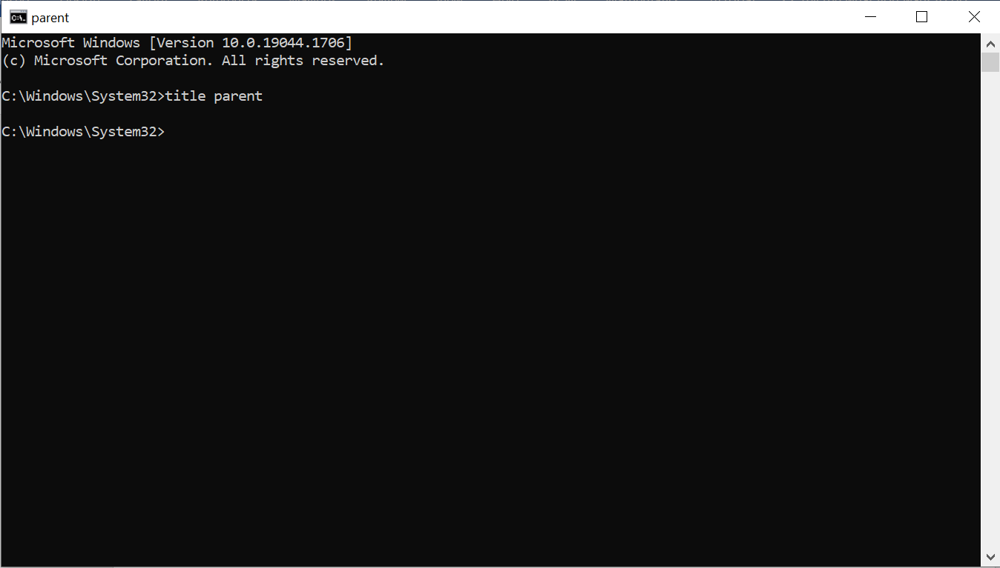
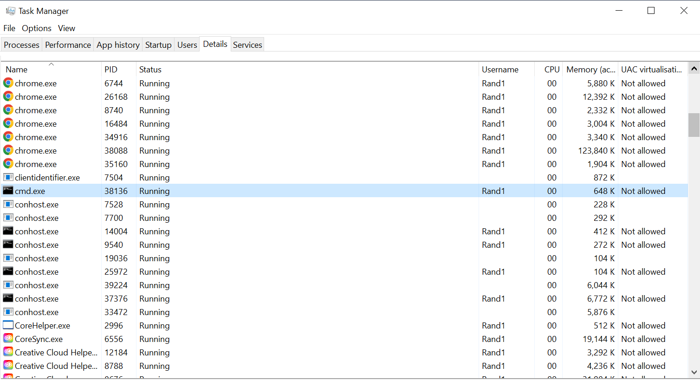
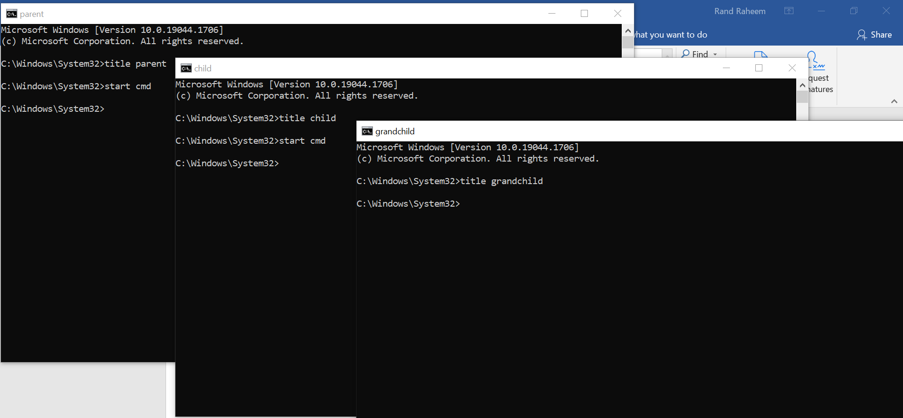
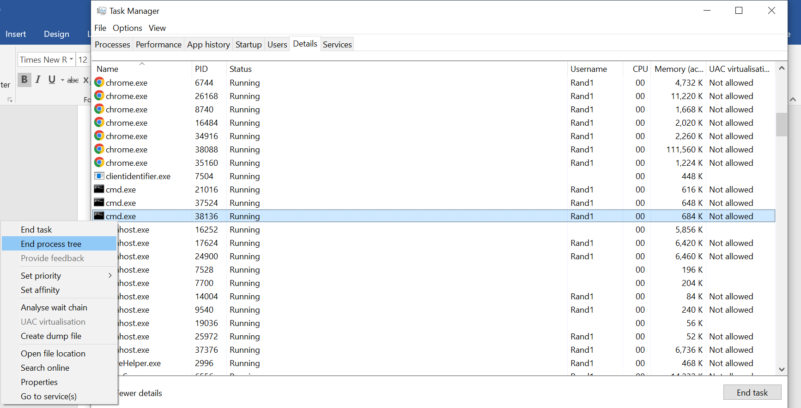

<!-- page: 1 -->
# CST1500 – Laboratory Worksheet - Week 4

This week will serve multiple purposes and is slightly different from the previous 3
weeks. Week 5 will resume the format from the past 3 weeks.
## Contents

Lecture videos to watch this week .........................................................................................................1
Week 4 Schedule.....................................................................................................................................1
An Introduction to Batch Files and Scripting in Windows ......................................................................2
## Lecture videos to watch this week

Lecture 08 Control Unit and Microprogramming
Lecture 09 Computer Architecture 2
## Week 4 Schedule

1. Week 4 will be used as a catch up for the lab exercises and lectures. Please
try to make sure you have watched all of the lectures from Lecture 01 –
Lecture 09 and have read through and completed the exercises from week
one to week three inclusive.
2. If you have completed everything, you may continue to the next lab below -
An Introduction to Batch Files and Scripting in Windows.
3. If you are up to date or when you have caught up, you can use this week to
work on Coursework One.
4. You may take the FORMATIVE Test 1 to test yourself on what you have
covered in the past 3 weeks. It covers material from the first 6 lectures
(Lecture 01 – Lecture 06 inclusive). This would be useful for your own
development as well as serving as an indicator of your progress to the
teaching team. Your lab tutor will provide you with the specified time for the
test in the lab.

<!-- page: 2 -->
## An Introduction to Batch Files and Scripting in Windows

## Lab Objectives

In this session, you will be introduced to some of the facilities that Windows provides
for scripting. Whilst the scripting languages supported by Windows are, in many cases,
quite different from those supported by Unix, the underlying purpose is the same – to
automate repetitive administrative tasks such as file backups, account creation and
software installation.
History of the Command-Line Language
Before there was Windows... there was the Microsoft Disk Operating System
commonly referred to as MS-DOS. There was also a popular operating system called
UNIX, but it was more popular with scientists and super computer users, while many
of the “ordinary folk” used MS-DOS. Whereas Windows has a lovely graphical user
interface, DOS was all done with text commands. That is, you typed out what you
wanted the computer to do. Later the Windows operating system was built on top of
DOS, so that DOS commands would run in the background, corresponding to how one
interacted with the graphical interface. For example, if you click and dragged a file to
a folder to move it, Windows would literally run the corresponding move command in
DOS.
Windows Command Prompt
So, how do we start giving text commands to Windows? First, we need to open the
command prompt (prompt for short or CMD). Click on the Windows Start Button, then
type “cmd” in the Search box, and click on the program cmd.exe that appears in the
search list. A cheery black and white window should pop up. Notice: there are no
menus! Click in the Command prompt window to begin entering commands.
Batch Files
Prior to Windows 98, the only scripting language supported by default in Windows was
the MSDOS batch file language. Although significantly more powerful scripting
languages are available in current versions of Windows (see below for details), batch
files can still provide useful functionality. As you would expect, the batch file syntax is
generally much easier to learn than the more powerful scripting languages such as
VBScript and Power-shell.
Hence, batch files are files that contain a list of commands. It executes the commands
within the file when you execute the batch file. The commands execute one by one. A
command within a batch file can be used to start/run another application, for example
you could start MS Word.
Why batch files are useful?
A batch file could be used to run frequently run commands, deleting a series of files,
moving files, copying files etc. A simple batch file does not require any special
programming skills and can be done by users who only know DOS commands.

<!-- page: 3 -->
An example of a well-known batch file is the autoexec.bat, which is a simple batch file
loaded each time the computer is loaded on MS-DOS and early Windows computers.
This batch file contained all the necessary commands and programs used to run MS￾DOS and Windows each time the computer booted.
Ref for further examples and information:
www.chebucto.ns.ca/~ak621/DOS/BatBasic.html
### EX 1: Getting started with Batch files

Creating Batch Files
Below are some examples of batch files. In each case, you should
1. Write the batch file using Windows Notepad.
2. Save the batch file(s) in your working directory. Note that batch files always have
an extension of (.bat). When saving (and running) your batch files, make sure that your
working directory is one in which you have the necessary permissions to create files
and directories.
3. Run the batch file by typing its name (without the .bat extension) at the command
prompt. Note that in the case of makedir.bat, you will need to provide the batch file
with a parameter. In the first instance, use test i.e. makedir test. In the case of
parent.bat and child.bat, you need to create both batch files and save them in your
working directory before you can run parent.bat.
4. Work out what the batch file does and how it does it.
Note that you can find a lot of useful information about batch files, including their
syntax, by pressing F1 on the Windows desktop and searching on the words batch
files.
makedir.bat
```cmd
@echo off
rem This batch file demonstrates the use of selection and
rem the substitution of variables from the command line
rem
rem Run this script using the command makedir parameter
rem where parameter is the name of the directory to be created.
rem
if “%1”==”” goto skip
mkdir %1\dir1
mkdir %1\dir2
mkdir %1\dir3
echo some text > %1\dir1\file1.txt
echo more text > %1\dir2\file2.txt
echo yet more text > %1\dir3\file3.txt
goto end
:skip
echo No directory specified
:end
```


<!-- page: 4 -->
What is the significance of the rem command and the variable %1? What are the Unix
equivalents of rem and %1? Make some notes.
### EX 2: Understanding batch code of parent/child relationship

To simply understand the parent/child relationship, start by opening a cmd window,
then give it a title e.g. parent - that is because will be opening more cmd windows and
we do not want to lose track of them all. Type in title parent and press enter.
You need to check your process ID (PID) by opening the Windows Task Manager.
Press ctrl, alt and delete together, then select Task Manager. Select the Details tab
in the task manager. Make a note of the PID – it is important.
Now create a child process by typing start cmd in the parent window and press enter,
name this window child, then create a grandchild process by typing start cmd in the
child window and press enter and call it grandchild.


*Figure 1 (Page 4)*



*Figure 2 (Page 4)*


<!-- page: 5 -->
All three process PIDs can be checked via your Windows Task Manager – collect the
PIDs as you create the cmds, as it is not easy to differentiate between them in the task
manager. Now if you remember which cmd is your parent process tree, right click on
it and then click on End Process Tree - that will end the entire tree. In other words, if
you kill the parent process, the entire process generation will be killed as well.
Now if you repeat the same procedures in terms of creating the parent, child and
grandchild processes, then you kill the child process what would happen? Explain why
that is happening. Why are the parent and grandchild still there? Now if you kill the
parent, why is the grandchild still there by itself? What do you know about Zombie
processes?
Let us get into more details about how to create batch parent/child processes and to
understand the relationship between them.


*Figure 3 (Page 5)*



*Figure 4 (Page 5)*


<!-- page: 6 -->
## Parent.bat and child.bat

parent.bat
```cmd
@echo off
for %%j in (1,2,3,4,5) do call child.bat
child.bat
set /p inputvar=Please type option #%j%:
echo You typed %inputvar% - Thank you.
In the above example, what is the precise relationship between parent.bat and
child.bat? Also, what values does parent.bat pass to child.bat and vice versa? Explain
your output to your lab tutor, SLA or classmate.
Another example of the parent.bat and child.bat
parent.bat
@echo off
rem This file demonstrates how one
rem batch file can call another cls
call child.bat first
set first=%inputvar%
call child.bat second
set second=%inputvar%
echo You typed %first% and then you typed rem %second%
child.bat
rem This batch file demonstrates how input
rem can be obtained from the user
set /p inputvar=Please type the %1 option:
echo Thank you
What is the precise relationship between parent.bat and child.bat? What values does
parent.bat pass to child.bat and vice versa? Make some notes.
```

### EX 3: Understanding batch code of looping mechanism

loop.bat
```cmd
@echo off
rem This batch file demonstrates the use of loops. For the third
rem loop to work you need to enter 1 or more parameters e.g.
rem loop parameter1 parameter2 parameter3
rem
for %%i in (rock paper scissors) do echo %%i
rem
for /l %%n in (0,10,100) do echo %%n
rem
:loop
if “%1”==”” goto end
for %%c in (%1) do echo %%c shift
goto loop
:end
pause
```


<!-- page: 7 -->
What is the significance of %%i, %%n and %%c? What is the purpose of the shift and
pause commands?
## The Windows Script Host

One of the features that traditionally distinguished Unix and Linux from Windows was
the availability of powerful scripting languages such Bash, Perl and Python. Originally
released as part of Windows 98, the Windows Script Host was Microsoft’s attempt to
address the absence of powerful scripting facilities in Windows and represented a
replacement for the rather limited batch file language.
As its name implies, the Windows Script Host (WSH) hosts a language and provides
a shell within which scripts can run. Scripts can be created in the language of your
choice provided that it is supported. By default, WSH supports VBScript and JScript
but a variety of additional languages, such as Perl, Python, Tcl and REXX, are also
available. If you want to learn a little bit about Perl (or some of the other freely available
WSH-compatible scripting languages), go to www.activestate.com from where you
can download the Perl software for Windows and access a significant amount of
documentation and code examples.
Windows supplies two programs used to run WSH scripts. Wscript.exe is used to run
WSH scripts from within the GUI environment whilst cscript.exe is used to run them
from the command line or within batch files.
### EX 4: Creating and understanding WSH Scripts

Below are some examples of VBScripts. In each case, you should:
1. Write the script using Windows Notepad.
2. Save the scripts in your working directory. Note that VBScripts always have an
extension of .vbs.
3. Run the script by i) double-clicking on its icon in Explorer or ii) typing at the
command prompt, cscript scriptname.vbs.
4. Work out what the script does and how it does it.
Note that you can find a lot of useful information about WSH by pressing F1 on the
Windows desktop and searching on the word WSH. Additional information and
numerous code samples are available at:
http://www.microsoft.com/technet/scriptcenter/scripts/default.mspx?mfr=true
helloworld.vbs
'this is my first VBScript
Wscript.echo "Hello World"
If when you run helloworld.vbs from the command prompt, you get an error to the
effect that the script cannot be found, you are in the wrong directory! You can either:
i) change directory so that the script is in the current directory
ii) specify the full path of the script e.g.
cscript “c:\documents and settings\michael\my documents\bin\helloworld.vbs”

<!-- page: 8 -->
iii) add the directory that contains the script to your path
Enter path /? to find out how to add directories to the current path.
### EX 5: Understanding the VBScripts I

What happens to the output from helloworld.vbs when you run it:
i) by double-clicking on its icon in Explorer?
ii) by using cscript on the command line?
Are there any advantages to running scripts from the command line rather than via the
GUI?
### EX 6: Understanding the VBScripts II

Discuss with your tutor the expected output and what details the following scripts
provide you with?
Processor.vbs
strComputer = "."
Set objWMIService = GetObject("winmgmts:\\" & strComputer &
"\root\CIMV2")
Set colCSes = objWMIService.ExecQuery("SELECT * FROM
Win32_ComputerSystem")
For Each objCS In colCSes
WScript.Echo "Computer Name: " & objCS.Name
WScript.Echo "System Type: " & objCS.SystemType
WScript.Echo "Number Of Processors: " &
objCS.NumberOfProcessors
Next
Set colProcessors = objWMIService.ExecQuery("Select * from
Win32_Processor")
For Each objProcessor in colProcessors
WScript.Echo "Manufacturer: " & objProcessor.Manufacturer
WScript.Echo "Name: " & objProcessor.Name
WScript.Echo "Description: " & objProcessor.Description
WScript.Echo "Processor ID: " & objProcessor.ProcessorID
WScript.Echo "Address Width: " &objProcessor.AddressWidth
WScript.Echo "Data Width: " & objProcessor.DataWidth
WScript.Echo "Family: " & objProcessor.Family
WScript.Echo "Maximum Clock Speed: " &
objProcessor.MaxClockSpeed
Next

<!-- page: 9 -->
Keyboard.vbs
strComputer = "."
Set objWMIService = GetObject("winmgmts:" _
& "{impersonationLevel=impersonate}!\\" & strComputer &
"\root\cimv2")
Set colItems = objWMIService.ExecQuery("Select * from
Win32_Keyboard")
For Each objItem in colItems
Wscript.Echo "Caption: " & objItem.Caption
Wscript.Echo "Description: " & objItem.Description
Wscript.Echo "Device ID: " & objItem.DeviceID
Wscript.Echo "Is Locked: " & objItem.IsLocked
Wscript.Echo "Layout: " & objItem.Layout
Wscript.Echo "Name: " & objItem.Name
Wscript.Echo "Number of Function Keys: " &
objItem.NumberOfFunctionKeys
Wscript.Echo "Password: " & objItem.Password
Wscript.Echo "PNP Device ID: " & objItem.PNPDeviceID
Next
### EX 7: Understanding the VBScripts III

Earlier you were asked if there were any advantages to running scripts from the
command line rather than via the GUI. On the basis of your experience with
keyboard.vbs, would you change your mind? Whatever the answer, give reasons.
### EX 8: Perform administrative tasks using Windows Command Line (Task 1)

Using the Windows Command Line create a folder on your desktop called “CST1500”,
inside that folder create three more folders called “a”, “b” and “c”.
Store a hostname in a text file called “hostname.txt” in folder “a”.
### EX 9: Perform administrative tasks using Windows Command Line (Task 2)

Store a structure of files in the C:\ drive in a file called “c_files_structure.txt” in folder
“b” (tip you have to use “dir” command).
### EX 10: Perform administrative tasks using Windows Command Line (Task 3)

Move folders “a” and “b” with their content to folder “c”.
### EX 11: Perform more complex administrative tasks using Batch scripting

i. What is the purpose of the Path command?
ii. Write a Batch script that checks if a path given as a parameter exists. If it does, then
it should print a message to the user informing them of the result. If it doesn’t work,
then it should create the path and inform the user that the path has been created
successfully.

