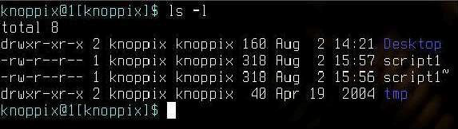
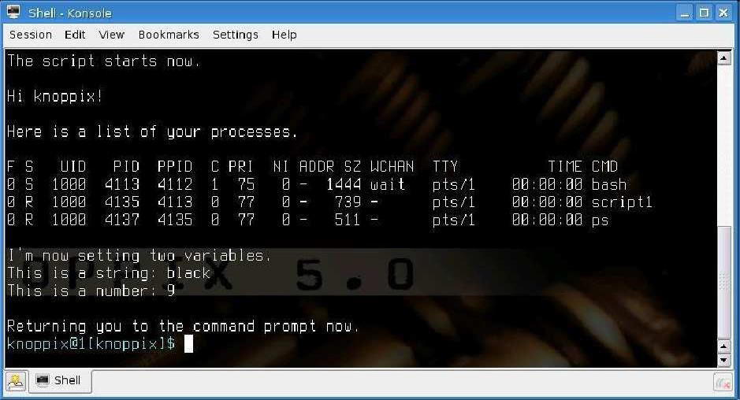
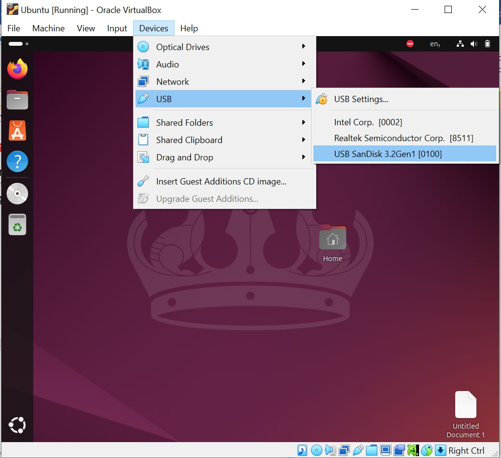
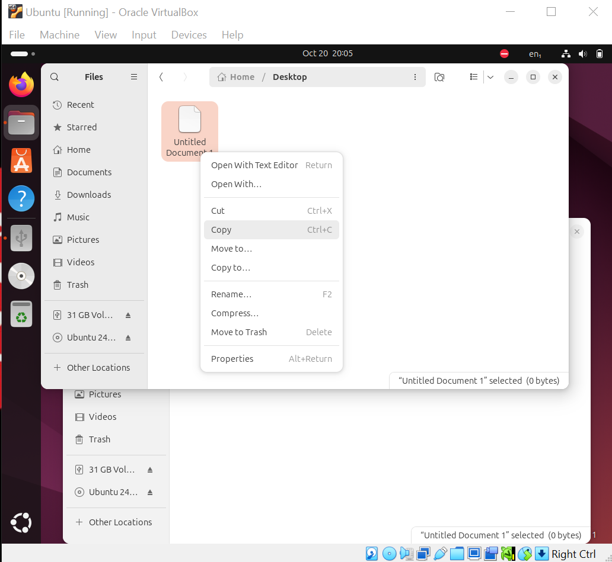
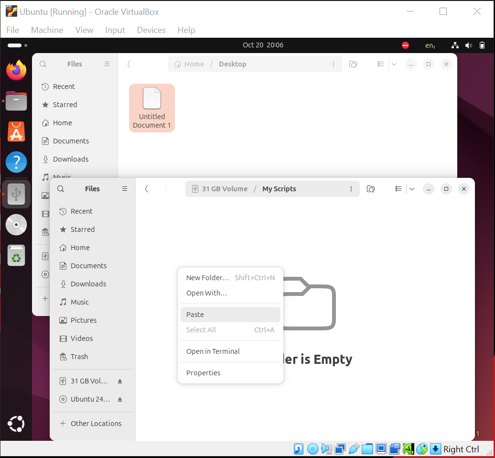
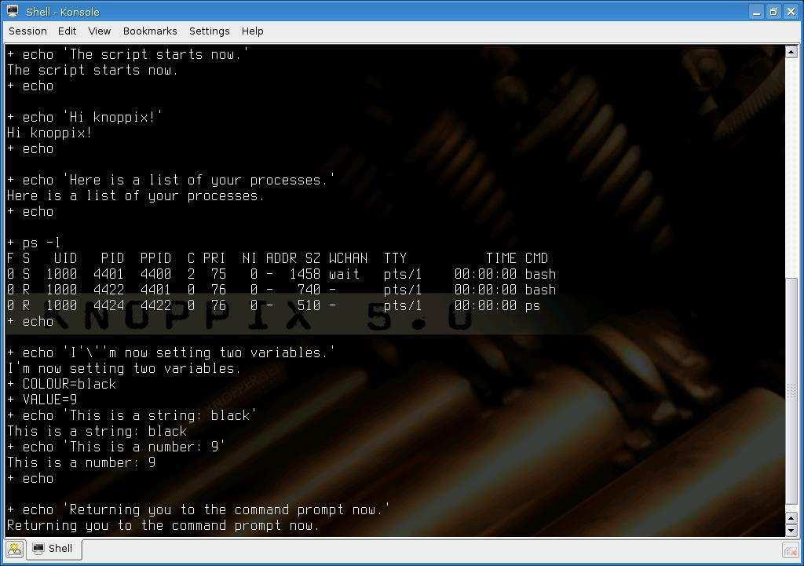

<!-- page: 1 -->
# CST1500 – Laboratory Worksheet - Week 5

These weekly laboratory worksheets provide information and exercises to complete
during class or at your own leisure. The practical exercises will assist you with your
coursework as well as provide you with valuable knowledge and skills. Please do your
best to keep up with the weekly laboratory worksheets in order to maximise your
potential for good marks and satisfactory progress in the module.
Exercises are denoted in red writing. For example:
### EX 1: Identification of PC parts (identify as many as you can).

## Contents

Lecture videos to watch this week........................................................................................................ 1
An Introduction to Unix Shell Scripting with Bash ................................................................................ 1
An introduction to Shell Scripting examples....................................................................................... 11
## Lecture videos to watch this week

Lecture 10 Introduction to Operating Systems
Lecture 11 Processes
## An Introduction to Unix Shell Scripting with Bash

## Lab Objectives

For the purposes of this lab session, you will be using Bash, the default Linux
command line shell. Others are available such the C shell. Once you have completed
the following exercises, you will need to consult the Bash Guide for Beginners and the
Advanced Bash Scripting Guide (upon which the following exercises are based), both
of which are available on-line and which will help you develop your understanding of
shell scripts.
Background
Shell scripts contain sequences of commands which are used to automate repetitive
tasks such as bulk account creation, bulk e-mail creation, backing up and installation
of software. Rather than running each one of the commands separately by entering it
at the command line, the system administrator can run the entire sequence in one go
by invoking the script. A working knowledge of shell scripting is essential for any
proficient system administrator but is also useful for software developers. However,
shell scripts are not suitable for all types of programming task. Read Chapter 1 of the
Advanced Bash Scripting Guide at: https://www.tldp.org/LDP/abs/html/ for a summary
of their advantages and disadvantages.

<!-- page: 2 -->
### EX 1: Writing Shell Scripts

PLEASE NOTE: The following text editor is only available on the Unix based
operating system.
Boot Ubuntu into its default GUI mode, or Fedora based on what you are using. Open
the terminal and type gedit to open the text editor. This is where you will be running
your shell scripts.
Gedit is an advanced text editor (there are many others which you could use including
vi which may recall from your earlier studies).
Gedit will now automatically indent and highlight your scripts according to the standard
Bash conventions. Now type the script, script1, on the next page.
Notice how Gedit automatically formats your code as you type it. When you have
finished typing script1, check it carefully and then save it by clicking on the save tab.
Call the file in the command line with the file name and save it in your home folder
/home
Then with the command chmod u+x followed by the file name, you can make the file
executable and then you can easily run your file through the command line interface.
Script1
```bash
#!/bin/bash
clear
echo "The script starts now."
echo
echo "Hi," $USER"!"
echo
echo "Here is a list of your processes:"
echo
ps l
echo
echo "I'm now setting two variables:"
COLOUR="Black"
VALUE="9"
echo "This is a string:" $COLOUR
echo "This is a number:" $VALUE
echo
echo "Returning you to the command prompt now."
```

### EX 2: Executing Shell Scripts

Shell scripts can be executed just like any other command. However, before you can
run your script, you will need to give it execute permission.
Open the console and enter the following command:

<!-- page: 3 -->
ls –l
which will list the files in your home directory. The output of the ls command should
be similar to fig. 1.
Fig. 1: Result of ls -l.
Each object in a Unix filesystem has a collection of permissions. The permissions for
the script, script1, are ‘rw-r--r--‘. The dash in the left-hand column (i.e. to the left of the
first ‘r’) indicates that script1 is a regular file. Desktop (above script1 in the directory
listing) is a directory, hence the ‘d’ in the left-hand column. The ‘rw-‘ permissions for
script1 indicate what the owner of the file, i.e. you, can do to it. You can read and write
it but not execute it (hence the ‘-‘). The remaining six permissions, in the case of
script1, ‘r--r--‘, relate to the group to which the owner belongs and all other users.
These two groups of users can read but not write script1. To make script1 executable,
enter the command
chmod u+x script1
where ‘u’ means owner and ‘+x’ means set executable permission. Check that script1
is now executable by entering the command
ls –l
again. The permissions for script1 should now be ‘rwxrr‘. You are now ready to run
your script.
Type script1 at the command prompt and press Enter.
If your script ran correctly, the output should resemble fig. 2. If it does not, check your
script against the original version above and make amendments where necessary.


*Figure 1 (Page 3)*


<!-- page: 4 -->
Fig. 2: Script1 output.
If your script did not run and you received an error message ‘Permission denied’ then
your script does not have execute permission. Check its permissions again using the
ls command and make the script executable using chmod.
If you received an error message ‘command not found’ the shell is unable to find your
script. You can solve this problem in a number of ways, the easiest of which are to
i) prefix the command with a ‘./’ i.e. ./script1. The ‘./’ tells the shell that the
script is in the current directory. Clearly this will not work if the script is not
in the current directory!
ii) add the directory which contains your script to your path. Path is an
environment variable (used both in Windows and Unix) that tells the
command interpreter where to find executables. Enter the command:
echo $PATH
to display details of your current path. Make a note of it.
You can add your home directory (assuming that is where you saved your script) to
the path using the command
export PATH=”$PATH:/home/ubuntu”
### EX 3: Saving Shell Scripts

Before you proceed any further, you need to save your script to a removable storage
device so that you can restore it to Ubuntu at a later stage or to Fedora based on what
you are using. Insert either a floppy disk or USB memory stick into your PC.
Select Devices -> USB -> Your USB HD


*Figure 2 (Page 4)*


<!-- page: 5 -->
Your USB HD should appear on the left.
You can now copy and paste the files you want from the VM to your USB HD. Or drag
and drop it.


*Figure 3 (Page 5)*


*Figure 4 (Page 5)*


<!-- page: 6 -->
### EX 4: Shell Script Basics

As mentioned in the introduction to this lab session, Bash is one of a number of
command line shells available for Unix and Linux. A shell script written for Bash will
not necessarily function correctly when run in another shell (and vice-versa). It is
important therefore that you define which shell you want to run your script. To run a
script in a Bash shell, you need to begin that script with the line
```bash
#!/bin/bash
This tells the current shell (which may or may not be Bash) that the following script
should be run in a Bash shell and that the Bash shell itself is located in the /bin
directory.
Like any program, it is always a good idea to add comments to your shell scripts so it
is clear what the script does. Everything the shell encounters after a # is treated as a
```



*Figure 5 (Page 6)*



*Figure 6 (Page 6)*


<!-- page: 7 -->
comment and ignored by the shell when executing the script. Make a copy of your
original script, script1, and call it script2. At this stage, the easiest way to do this is to
open script1 in gedit and save it as script2. Now add to your version of script2 the
comments contained below.
Script2
```bash
#!/bin/bash
# This script clears the terminal, displays a greeting and
information about current processes. It then sets and displays
two variables.
clear # Clear terminal
echo "The script starts now."
echo
echo "Hi," $USER"!" # Display user’s name
echo
echo "Here is a list of your processes:"
echo
ps l # List user’s processes
echo
echo "I’m now setting two variables."
COLOUR="black" # Set variables
VALUE="9"
echo "This is a string:" $COLOUR # Display contents of variables
echo "This is a number:" $VALUE
echo
echo "Returning you to the command prompt now."
Save script2, run it and check that the output is the same as before.
```

### EX 5: Debugging Shell Scripts

Bash provides extensive debugging facilities in the event that your scripts contain
errors. One of the most useful facilities is the –x option which allows you to run your
scripts in debug mode. In debug mode, traces of each command plus its arguments
are displayed after the commands have been expanded but before they are executed.
Try the following command:
bash –x script2
Your output should resemble fig. 4.

<!-- page: 8 -->
Fig. 4: Debugging scripts.
Each line that begins with a + contains a command that has been expanded. You can
examine these lines to ensure that the shell is actually executing what you think it
should be executing.
### EX 6: More examples of Shell Scripts I

Script1 and script2 were simple scripts that contained just sequences of commands.
Shell scripts support a wide range of advanced features including selection and
iteration and variable substitution from the command line. The following scripts are
designed to illustrate these more advanced features. Type each one, save it and then
run it. Debug it using the –x option, if necessary. Make sure also that you save all of
your scripts to a removable storage device.
Script3
```bash
#!/bin/bash
# Check if the number of arguments is not equal to 2
if [ ! $# -eq 2 ]; then
echo "Usage: $0 weight_in_kilos height_in_centimeters"
exit 1
fi
# Assign command-line arguments to variables
weight="$1"
height="$2"
```



*Figure 7 (Page 8)*


<!-- page: 9 -->
# Calculate ideal weight
idealweight=$((height - 110))
# Check if the weight is less than or equal to the ideal
weight
if [ "$weight" -le "$idealweight" ]; then
echo "You should eat a bit more fat."
else
echo "You should eat a bit more fruit."
fi
What is the significance of the variables $#, $1 and $2?
What is the expected output when you run the following command
script3 95 193
If the significance of the variables $#, $1 and $2 is not clear, script4 should make it
clearer.
Script4
```bash
#!/bin/bash
clear
echo "This script demonstrates how the values of certain variables"
echo "such as \$#, \$@, \$0, \$1, \$2 etc. are automatically set"
echo "by the shell prior to execution of scripts"
echo "\$0 is set to the command name which is $0"
echo "\$# is set to the number of parameters which = $#"
if [ $# -ne 0 ]; then
echo "\$@ contains a list of all the parameters"
echo "supplied on the command line. Therefore:"
echo
echo "\$@ = $@"
echo
echo "\$1 is set to the first parameter in \$@"
echo "\$2 is set to the second parameter in \$@"
echo "\$3 is set to the third parameter and so on"
echo "Therefore:"

argsleft=$#
currentparam=1
while [ $argsleft -gt 0 ]; do
echo "\$$currentparam = ${!currentparam}" # Using indirect reference
argsleft=$((argsleft - 1)) # Decrement argsleft
currentparam=$((currentparam + 1)) # Increment currentparam
done
else
echo "No parameters were supplied."
fi
Script4 displays values for a number of environment variables including $#, $@ and
$0. When you first run script4, run it without any parameters i.e. just enter:
```


<!-- page: 10 -->
script4 (or ./script4 if the shell cannot find script4)
### EX 7: More examples of Shell Scripts II

Run script4 a second time, but, this time enter
script4 one two three four five six
Compare the output with the output obtained previously. Run the script several more
times varying both the number of parameters and their values. What effect does this
variation have on the environment variables $#, $@, etc.? Copy script4, giving the
copy a different name e.g. script4a. Run script4a. What is the value of $0 now?
Environment variables can be used to control the execution of scripts. For example,
you could test $1, $2 etc. for the presence of required values. If these values are
missing (i.e. the user did not supply them on the command line), your script can be
designed to exit with a suitable error message. Script3 above illustrates how this can
be done.
### EX 8: More examples of Shell Scripts III

Script 5
```bash
#!/bin/bash
#This script displays a message between 1 and 10 times according
the the #number specified by the user. It demonstrates how input
can be collected #from the user.
#
# source of script unknown #
echo -n "Enter a number between 1 and 10 and press [ENTER]: "
read number
while [ $number -gt 0 ]
do
echo -n "You ARE Wonderful!"
number=$[ $number-1 ]
done
Script5 should work fine provided that you enter a number between 1 and 10. But what
happens if you enter a number outside that range or indeed no number at all or a
nonnumeric character? Try some of these scenarios. Make a note of what happens.
How would you amend script5 so that it handles the above error conditions properly?
```


<!-- page: 11 -->
## An introduction to Shell Scripting examples

## Lab Objectives

This lab will look at more Shell scripts examples. Please read the following documents
for additional information in Shell script programming:
i. BASH Guide for Beginners (Machtelt Garrels)
ii. BASH Scripting Tutorial.
### EX 9: mysystem.sh example using ‘echo’

The mysystem.sh script below executes some well-known commands (date, w,
uname, uptime) to display information about you and your machine.
mysystem.sh
1 #!/bin/bash
2 clear
3 echo "This is information provided by mysystem.sh. Program
starts now."
4
5 echo "Hello, $USER"
6 echo
7
8 echo "Today's date is `date`, this is week `date +"%V"`."
9 echo
10
11 echo "These users are currently connected:"
12 w | cut -d " " -f 1 - | grep -v USER | sort -u
13 echo
14
15 echo "This is `uname -s` running on a `uname -m` processor."
16 echo
17
18 echo "This is the uptime information:"
19 uptime
20 echo
21
22 echo "That's all folks!"
A script always starts with the same two characters, "#!". After that, the shell that will
execute the commands following the first line is defined. This script starts with clearing
the screen on line 2. Line 3 makes it print a message, informing the user about what
is going to happen. Line 5 greets the user. Lines 6, 9, 13, 16 and 20 are only there for
orderly output display purposes. Line 8 prints the current date and the number of the
week. Line 11 is again an informative message, like lines 3, 18 and 22. Line 12 formats
the output of the w; line 15 shows operating system and CPU information. Line 19
gives the uptime and load information.

<!-- page: 12 -->
Both echo and printf are Bash built-in commands. The first always exits with a 0 status,
and simply prints arguments followed by an end of line character in the standard
output, while the latter allows for definition of a formatting string and gives a non-zero
exit status code upon failure.
### Task 1: Explain line 12. Find out the information from Google about 'cut', 'grep' and

'sort'.
### EX 10: mysystem.sh example using ‘printf’

The same script is written using the built-in 'printf' as the following shows:
Mysystem.sh
```bash
#!/bin/bash
clear
printf "This is information provided by mysystem.sh. Program
starts now.\n"
printf "Hello, $USER.\n\n"
printf "Today's date is `date`, this is week `date +"%V"`.\n\n"
printf "These users are currently connected:\n"
w | cut -d " " -f 1 - | grep -v USER | sort -u
printf "\n"
printf "This is `uname -s` running on a `uname -m`
processor.\n\n"
printf "This is the uptime information:\n"
uptime
printf "\n"
printf "That's all folks!\n"
```

### Task 2: Can you see any difference in the output? Make a comment on 'printf' output.

### EX 11: Understanding more of creating and exporting variables in Linux

Creating variables
Variables are case sensitive and capitalised by default. Giving local variables a
lowercase name is a convention which is sometimes applied. However, you are free
to use the names you want or to mix cases. Variables can also contain digits, but a
name starting with a digit is not allowed.
To set a variable in the shell, use
VARNAME="value"
Putting spaces around the equal sign will cause errors. It is a good habit to quote
content strings when assigning values to variables: this will reduce the chance that
you make errors.
Some examples using upper and lower cases, numbers and spaces:

<!-- page: 13 -->
prompt> MYVAR1="2"
prompt> echo $MYVAR1
2
prompt> first_name="Franky"
prompt> echo $first_name
Franky
prompt> full_name="Franky M. Singh"
prompt> echo $full_name
Franky M. Singh
prompt> MYVAR-2="2"
bash: MYVAR-2=2: command not found
prompt> MYVAR1 ="2"
bash: MYVAR1: command not found
prompt> MYVAR1= "2"
bash: 2: command not found
prompt> unset MYVAR1 first_name full_name
prompt> echo $MYVAR1 $first_name $full_name
<--no output-->
Exporting variables
A variable created like the ones in the example above is only available to the current
shell. It is a local variable: child processes of the current shell will not be aware of this
variable. In order to pass variables to a subshell, we need to export them using the
export built-in command.
Variables that are exported are referred to as environment variables. Setting and
exporting is usually done in one step:
export VARNAME="value"
A subshell can change variables it inherited from the parent, but the changes made
by the child don't affect the parent. This is demonstrated in the following examples:
prompt> full_name="Franky M. Singh"
prompt> bash
prompt> echo $full_name
prompt> exit
prompt> export full_name
prompt> bash
prompt> echo $full_name
Franky M. Singh

<!-- page: 14 -->
prompt> export full_name="Charles the Great"
prompt> echo $full_name
Charles the Great
prompt> exit
prompt> echo $full_name
Franky M. Singh
When first trying to read the value of full_name in a subshell, it is not there (echo shows
a null string). The subshell quits, and full_name is exported in the parent - a variable
can be exported after it has been assigned a value. Then a new subshell is started, in
which the variable exported from the parent is visible. The variable is changed to hold
another name, but the value for this variable in the parent stays the same.
A list of reserved variables and special parameters are given in section 3, reference
(i).
### EX 12: Understanding more Linux commands

Escape characters
Escape characters are used to remove the special meaning from a single character.
A non-quoted backslash, \, is used as an escape character in Bash. It preserves the
literal value of the next character that follows, with the exception of newline. If a
newline character appears immediately after the backslash, it marks the continuation
of a line when it is longer that the width of the terminal; the backslash is removed from
the input stream and effectively ignored.
prompt> date=20021226
prompt> echo $date
20021226
prompt> echo \$date
$date
In this example, the variable date is created and set to hold a value. The first echo
displays the value of the variable, but for the second, the dollar sign is escaped.
## Single quotes

Single quotes (' ') are used to preserve the literal value of each character enclosed
within the quotes. A single quote may not occur between single quotes, even when
preceded by a backslash.
prompt> echo '$date'
$date

<!-- page: 15 -->
## Double quotes

Using double quotes, the literal value of all characters enclosed is preserved, except
for the dollar sign, the backticks (backward single quotes, ``) and the backslash. The
dollar sign and the backticks retain their special meaning within the double quotes.
The backslash retains its meaning only when followed by dollar, backtick, double
quote, backslash or newline. Within double quotes, the backslashes are removed from
the input stream when followed by one of these characters. Backslashes preceding
characters that don't have a special meaning are left unmodified for processing by the
shell interpreter. A double quote may be quoted within double quotes by preceding it
with a backslash.
prompt> echo "$date"
20021226
prompt> echo "`date`"
Sun Apr 20 11:22:06 CEST 2003
prompt> echo "I'd say: \"Go for it!\""
I'd say: "Go for it!"
prompt> echo "\"
More input>"
prompt> echo "\\"
\
Shell expansion
After the command has been split into tokens, these tokens or words are expanded or
resolved. This is discussed in the next sections.
Brace expansion
Brace expansion is a mechanism by which arbitrary strings may be generated.
Patterns to be brace-expanded take the form of an optional PREAMBLE, followed by
a series of comma-separated strings between a pair of braces, followed by an optional
POSTSCRIPT. The preamble is prefixed to each string contained within the braces,
and the postscript is then appended to each resulting string, expanding left to right.
Brace expansions may be nested. The results of each expanded string are not sorted;
left to right order is preserved.
prompt> echo sp{el,il,al}l
spell spill spall
Shell parameter and variable expansion
The "$" character introduces parameter expansion, command substitution, or
arithmetic expansion. The parameter name or symbol to be expanded may be

<!-- page: 16 -->
enclosed in braces, which are optional but serve to protect the variable to be expanded
from characters immediately following it which could be interpreted as part of the
name. The basic form of parameter expansion is "${PARAMETER}". The value of
"PARAMETER" is substituted.
prompt> echo $SHELL
/bin/bash
The following construct allows for creation of the named variable if it does not yet exist:
${VAR:=value}
Example:
prompt> echo $FRANKY
prompt> echo ${FRANKY:=Franky}
Franky
Command substitution
Command substitution allows the output of a command to replace the command itself.
Command substitution occurs when a command is enclosed like this:
$(command)
or like this using back-ticks:
`command`
Bash performs the expansion by executing COMMAND and replacing the command
substitution with the standard output of the command, with any trailing newlines
deleted. Embedded newlines are not deleted, but they may be removed during word
splitting.
Arithmetic expansion
Arithmetic expansion allows the evaluation of an arithmetic expression and the
substitution of the result. The format for arithmetic expansion is:
$(( EXPRESSION ))
The expression is treated as if it was within double quotes, but a double quote inside
the parentheses is not treated specially. All tokens in the expression undergo
parameter expansion, command substitution, and quote removal. Arithmetic
substitutions may be nested.
A list of Arithmetic expressions is given in the reference note (i).

<!-- page: 17 -->
## Introduction to if - General

At times you need to specify different courses of action to be taken in a shell script,
depending on the success or failure of a command. The if construction allows you to
specify such conditions. The most compact syntax of the if command is:
if TEST-COMMANDS; then CONSEQUENT-COMMANDS; fi
The TEST-COMMAND list is executed, and if its return status is zero, the
CONSEQUENT-COMMANDS list is executed. The return status is the exit status of
the last command executed, or zero if no condition tested true.
The TEST-COMMAND often involves numerical or string comparison tests, but it can
also be any command that returns a status of zero when it succeeds and some other
status when it fails. Unary expressions are often used to examine the status of a file.
If the FILE argument to one of the primaries is of the form /dev/fd/N, then file descriptor
"N" is checked. stdin, stdout and stderr and their respective file descriptors may also
be used for tests.
### EX 13: More examples of using if statement in bash script

Example1: Testing if a file exists. The script also gives information about a file
```bash
#!/bin/bash
FILENAME="$1"
echo "Properties for $FILENAME:"
if [ -f $FILENAME ]; then
echo "Size is $(ls -lh $FILENAME | awk '{ print $5 }')"
echo "Type is $(file $FILENAME | cut -d":" -f2 -)"
echo "Inode number is $(ls -i $FILENAME | cut -d" " -f1 -)"
echo "$(df -h $FILENAME | grep -v Mounted | awk '{ print
"On",$1", \ which is mounted as the",$6,"partition."}')"
else
echo "File does not exist."
Fi
Example2: More use of if statement in bash script
Inside the if statement, you can use another if statement. You may use as many levels
of nested ifs as you can logically manage. This is an example testing leap years.
testleap.sh
#!/bin/bash
year=`date +%Y`
if [ $[$year % 400] -eq "0" ]; then
echo "This is a leap year. February has 29 days."
elif [ $[$year % 4] -eq 0 ]; then
if [ $[$year % 100] -ne 0 ]; then
echo "This is a leap year, February has 29 days."
else
```


<!-- page: 18 -->
echo "This is not a leap year. February has 28 days."
fi
else
echo "This is not a leap year. February has 28 days."
Fi
prompt> ./testleap.sh
Discuss the obtained output of Example 1 and 2 with your lab tutor, SLA or classmate.
### EX 14: Example using Boolean Operations

Boolean Operations
Example 2 can be shortened using the Boolean operators “AND” (&&) and “OR” (||) as
shown below:
```bash
#!/bin/bash
year=`date +%Y`
if (((“$year” % 400) == “0”)) || (( ( “$year” % 4 == “0”) &&
(“$year” % 100 != “0”) )); then
echo "This is a leap year. Don’t forget to charge the extra
day!”
else
echo "This is not a leap year."
Fi
We use the double brackets for testing an arithmetic expression. This is equivalent to
the let statement. You will get stuck using square brackets here, if you try something
like $[$year % 400], because here, the square brackets don't represent an actual
command by themselves.
```

### EX 15: Perform basic tasks using Bash scripting

### Task 1: Write a shell script to see current date, time, username, and current directory.

The expected output is going to look something similar to the following:
Expected Output
Current Date:
Wed Jan 15 14:53:27 UTC 2020
Username:
root
Current directory:
/home
### Task 2: Understand and discuss the following bash script and its expected output with

your lab tutor, SLA or classmate.

<!-- page: 19 -->
```bash
#!/bin/bash
echo –n “Enter number:”
read n
sd=0
rev=””
on=$n
while [$n –gt 0]
do
sd=$(( $n % 10 ))
n=$(( $n / 10 ))
rev=$( echo ${rev}${sd} )
done
echo “$on in a reverse order $rev”
```

### Task 3: Understand and discuss the following bash script and its expected output with

your lab tutor, SLA or classmate.
```bash
#!/bin/bash
echo –n “Enter number:”
read n
sd=0
sum=0
while [$n –gt 0]
do
sd=$(( $n % 10 ))
n=$(( $n / 10 ))
sum=$(( $sum + $sd ))
done
echo “Sum of all digit is $sum”
```

### EX 16: Perform more complex tasks using Bash scripting

### Task 1: Write a shell script that will print the message "Hello World" in Bold and Blink

effect, and in different colours like red, green etc. using the echo command.
### Task 2: Write a shell script to find the biggest number from three given numbers. The

numbers are given as a command line argument. Print error if sufficient arguments are
not supplied.
### EX 17: Perform more advance tasks using Bash scripting

### Task 1: Write a shell script that will add two numbers which are supplied as a command

language argument. If the two numbers are not given, show a suitable error message.
### Task 2: Write a shell script to print numbers 5, 4, 3, 2, 1 using a while loop.


